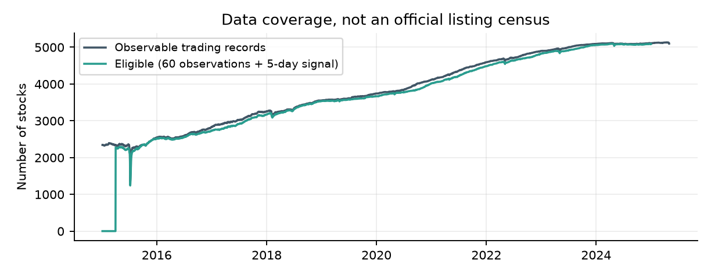
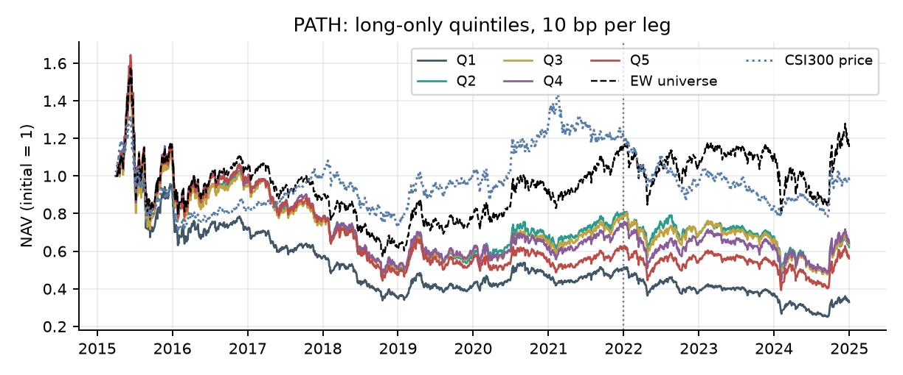
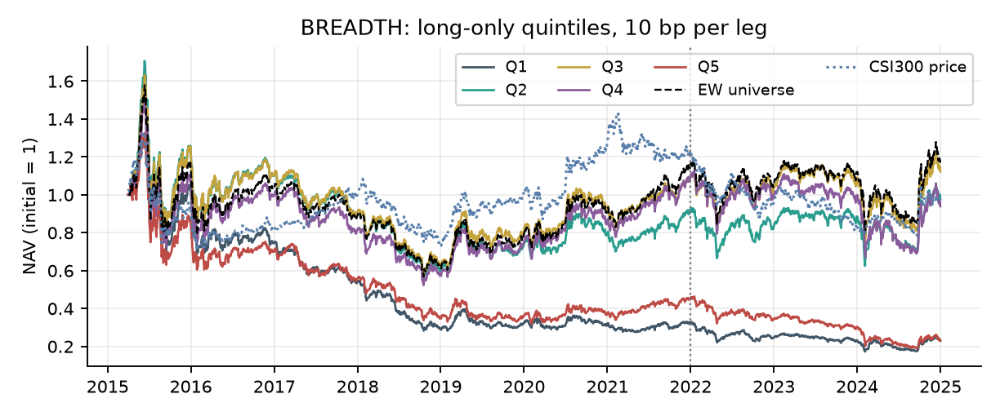
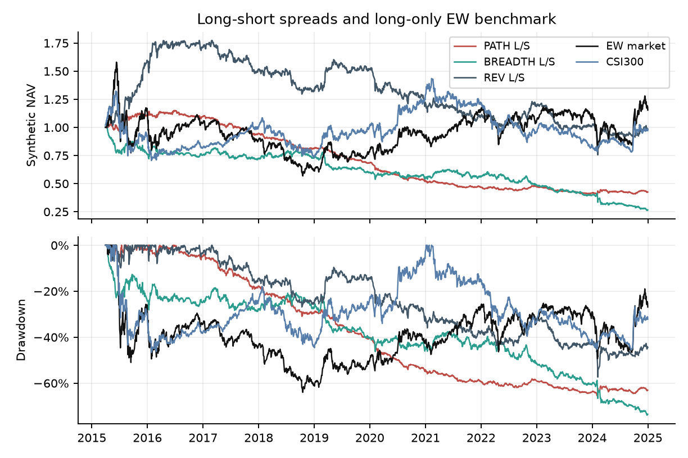
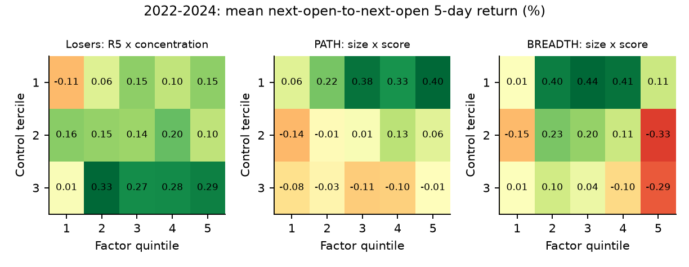
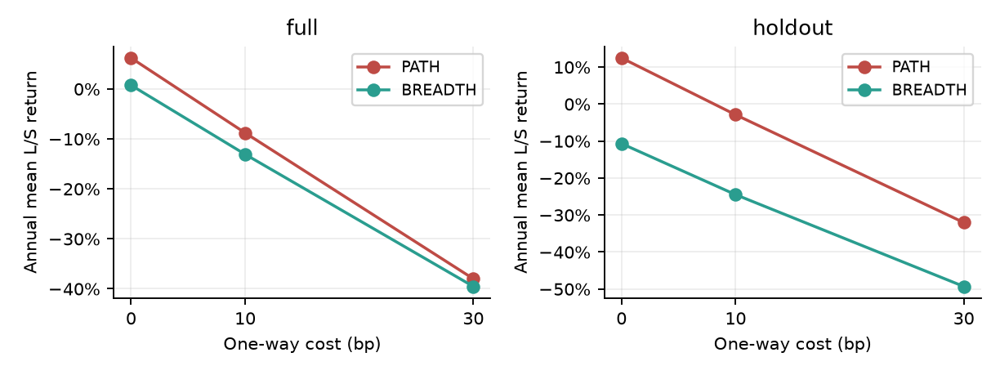

A股下跌路径与市场广度

两个因子的计算、交易模拟与资产定价检验

研究区间：2015-04-01至2024-12-31
固定留出区间：2022-2024
数据：F.I.R.E.公开A股日频面板
主成本：单边10bp；全市场有效样本五分组

核心结论

路径集中度（PATH）：留出期多空年化均值-2.91%，四因子年化Alpha 0.67%，HAC t=0.10，两主检验Holm校正p=0.921；未通过正Alpha主检验。

市场广度状态（BREADTH）：留出期多空年化均值-24.51%，四因子年化Alpha -27.92%，HAC t=-3.27，两主检验Holm校正p=0.002；未通过正Alpha主检验。

最直接的经济结论：PATH留出期无成本年化均值为12.45%，单边10bp后降为-2.91%，费用与换手足以改变方向。路径的控制后增量关系和广度的条件调节均缺乏留出期统计支持。

以上Alpha使用本研究按事前规则重建的本地FF式风险因子代理，已运行CAPM、FF3和Carhart四因子模型结构；结果不等同于使用官方标准因子序列。固定年化1.5%的RF属于假设，报告同时给出0%和3%的敏感性。

报告保留所有预设方向、窗口与成本结果，包括不支持假设的证据。多空收益是100%多头与100%空头的研究组合，未计融券费及保证金，不构成可执行收益承诺。

主回测版本：19cf532c4208
方案冻结提交：a5f6d25；实现澄清见PROTOCOL.md。

## 目录与课程要求对应

阅读顺序：先看核心结论，再看样本、执行口径和主检验；原始假设是否成立主要由双重排序与增量回归回答。

- [1. 数据组成与样本边界](#section2)
- [2. 事前固定方案与成交时间线](#section3)
- [3. 因子定义与行为金融假设](#section4)
- [4. 路径因子：全市场Q1至Q5](#section5)
- [5. 市场广度状态因子：全市场Q1至Q5](#section6)
- [6. 多空收益、基准与最大回撤](#section7)
- [7. CAPM、FF3和四因子Alpha比较](#section8)
- [8. 回到原问题：相近跌幅内比较路径](#section9)
- [9. 增量信息与经济解释的检验](#section10)
- [10. 规模、价格与流动性独立排序](#section11)
- [11. 子时期、成本与替代proxy](#section12)
- [12. 数据审计、RF敏感性与实现验证](#section13)
- [13. 结论、局限与展示重点](#section14)
- [14. 复现、文件索引与参考资料](#section15)

| 课程要求              | 对应证据                  |
|:------------------|:----------------------|
| 数据组成、回测区间         | 第1-2节；完整字段和数据指纹       |
| CAPM、FF3、四因子Alpha | 第7节；本地FF式代理，明确来源边界    |
| 策略与proxy、禁止数据挖掘   | 第2-3节及事前提交PROTOCOL.md |
| Q1-Q5与多空、市场及回撤    | 第4-7节；同时比较EW和沪深300    |
| 行为金融解释、增量信息       | 第3、8-10节；区分假设与因果证据    |
| 控制排序、时期、成本        | 第10-12节；固定辅助检验全部保留    |

## 1. 数据组成与样本边界

本次读取真实Feather文件，原始字段覆盖2015-01-05至2025-04-30，2509个日期、5362个沪深A股代码。研究收益序列包含2374个交易日，首末有效股票数为0与5085。

60个历史观察的暖启动使开始阶段持有现金；首次合格日期为2015-04-03，固定五日调仓网格上的首次实际入场为2015-04-10。原包5363列中，代码筛选排除的302132.SZ仅有2025年记录，不改变2015-2024回测样本。

| 类别    | 读取字段                                                     | 用途                       |
|:------|:---------------------------------------------------------|:-------------------------|
| 量价    | open、close、volume、money                                  | 调整开收盘用于收益与成交；成交额用于Amihud |
| 原始价格  | close_dr                                                 | 原价分组控制，不用于与复权价混算收益       |
| 规模与价值 | market_cap_ashare、circulating_market_cap_ashare、pb_ratio | 规模控制、加权广度和本地风险模型         |
| 校验字段  | return_adj、turnover_ratio                                | 收益单位核对；换手字段留作数据审计        |

图1：真实可观察记录与策略有效股票数。它不是完整历史上市证券普查。

全零或完全缺失代码：0；最后正价早于数据末日的代码：217。缺少权威历史上市/退市名单，不能据此证明无幸存者偏差。本文“全市场五分组”指公开数据内满足事前条件的全部沪深A股，不是官方全A股总体。

## 2. 事前固定方案与成交时间线

| 项目    | 固定口径                                  |
|:------|:--------------------------------------|
| 窗口    | 过去5个交易日；每5个交易日形成一次组合                  |
| 准入    | 沪深A股代码；累计60个正价观察；有效5日收益；形成日正价且有成交量    |
| 形成与入场 | t收盘后计算信号；t+1开盘调仓；按当天收盘估值              |
| 分组    | 所有合格股票同日独立排序Q1至Q5；平均秩处理同分，不按代码拆分      |
| 账户    | 各组等权目标；先卖后买；拒绝买入留现金、拒绝卖出继续持有          |
| 成交代理  | 相对上日调整收盘，开盘涨幅>=9.5%不买、跌幅<=-9.5%不卖     |
| 交易成本  | 主情景单边10bp；0bp及30bp只作敏感性，含两腿成本         |
| 基准    | 同一合格股票池、同一调仓规则与成本的等权多头EW              |
| 样本划分  | 2015-2020开发、2021验证、2022-2024固定留出；不挑参数 |
| 主假设   | 两个留出期Q5-Q1的正四因子Alpha，双侧p做Holm两重校正     |

不使用次日结果决定今天买谁

股票池和分数只读取t及以前的值。未来开盘缺失的股票不会从t的入选名单中事后剔除。不能成交时账户保留现金或旧持仓；缺失收盘时按最后正价估值，并记录滞价资金占比。调仓间隔五个交易日，买入日没有再次卖出新买份额。

正价但全天零成交的记录只用于判定订单执行失败，不回改选股；未成交买入不重新分配权重。全天正成交量不能保证开盘成交。数据验收后发现的停牌延续报价及对应修正记录在IMPLEMENTATION_LOG.md。

该成交代理无法精确区分ST、主板、创业板和科创板的不同限制，亦没有盘口排队、手数与资金容量模型。调整价格构成分数股研究账户。9.5%规则只是保守假设，并非历史法规复刻。

冻结方案在读取策略结果前提交，但所有年份均属于历史回测；“留出”表示本次没有利用该段收益调整规则，不等于真实未来投资验证。

## 3. 因子定义与行为金融假设

PATH：相同五日跌幅，损失集中程度是否重要？

令r为调整收盘价的日对数收益，R5为最近五日r之和。loss=max(-r,0)，gain=max(r,0)。当R5<0时，PATH=max(loss)/sum(loss)；当R5>0时，PATH=-max(gain)/sum(gain)；R5=0时取0。

五天等量下跌得到0.2；全部负收益集中一天得到1。上涨股票使用对称负号，使所有合格股票都能五分组。这个扩展混合了反转方向与路径特征；原始问题另在下跌股票内部控制累计跌幅检验。替代proxy将最大份额换为份额平方和HHI。

行为假设：集中的负面冲击更容易吸引注意、激活损失厌恶或触发集中卖压，若价格短暂偏离估值，可能随后反弹。相反，渐进下跌也可能反映信息扩散和慢速价格调整。集中下跌可能是基本面永久恶化，因而方向不必然成立。

BREADTH：市场共同下跌是否改变反转状态？

每日b为有效交易股票中收益为负的比例，平盘真实交易记录保留在分母；B为最近五日b的平均。BREADTH=(2B-1)×(-R5)。B>0.5时按反转排序；B<0.5时按动量排序；B=0.5时同分。

B对同日个股相同，正的公共倍数不会改变横截面排序。因此本定义明确使用以0.5为中心的状态切换，不把公共市场指标伪装成独立个股信息。普通REV=-R5是必需基线；替代proxy用上一日流通市值加权的下跌比例。

行为假设：普跌可能与共同悲观、注意力冲击或流动性收缩相关；局部下跌可能更贴近个股信息。但普跌也可能反映系统性风险，收益差不直接识别非理性。增量检验控制过去市场收益与波动。

最接近文献之一为Da、Gurun和Warachka（2014）的信息连续性与动量研究。本作业定位于短窗A股扩展和增量信息检验，不主张首次发现“路径效应”或“状态效应”。参考文献见末节。

## 4. 路径因子：全市场Q1至Q5

图：PATH五组净值，单边10bp；同时比较等权样本基准与沪深300价格指数，竖线为留出期起点。

| 分组   | 年化收益   | 超RF     | 超EW     | 四因子α   |   α的t |
|:-----|:-------|:--------|:--------|:-------|------:|
| Q1   | -8.52% | -10.01% | -13.65% | -9.65% | -5.82 |
| Q2   | -1.41% | -2.90%  | -6.54%  | -5.16% | -3.48 |
| Q3   | -0.93% | -2.42%  | -6.06%  | -4.74% | -3.41 |
| Q4   | -0.81% | -2.30%  | -5.94%  | -4.72% | -2.45 |
| Q5   | -2.53% | -4.02%  | -7.66%  | -6.67% | -3.49 |

表：全样本年化算术均值；超RF使用1.5%年化代理，超EW为相同日期收益差。本地FF式四因子Alpha只覆盖风险因子共同可用月份，与全样本年化收益不完全同区间。

| 分组   | CAPM α   | FF3 α   | Carhart4 α   | 留出Carhart4 α   |
|:-----|:---------|:--------|:-------------|:---------------|
| Q1   | -10.81%  | -9.91%  | -9.65%       | -13.60%        |
| Q2   | -6.26%   | -5.53%  | -5.16%       | -7.55%         |
| Q3   | -5.84%   | -5.39%  | -4.74%       | -6.97%         |
| Q4   | -6.25%   | -5.37%  | -4.72%       | -0.83%         |
| Q5   | -7.82%   | -6.82%  | -6.67%       | 1.42%          |

本地FF式代理模型。三模型使用相同月份，防止把样本变化当作Alpha变化。全部t、p、载荷与样本数见results/alpha_local_proxy.csv。

## 5. 市场广度状态因子：全市场Q1至Q5

图：BREADTH五组净值，单边10bp；同时比较等权样本基准与沪深300价格指数，竖线为留出期起点。

| 分组   | 年化收益    | 超RF     | 超EW     | 四因子α    |   α的t |
|:-----|:--------|:--------|:--------|:--------|------:|
| Q1   | -12.28% | -13.77% | -17.41% | -14.11% | -5.75 |
| Q2   | 3.23%   | 1.75%   | -1.90%  | -1.45%  | -0.82 |
| Q3   | 4.96%   | 3.47%   | -0.17%  | 0.29%   |  0.18 |
| Q4   | 3.35%   | 1.86%   | -1.78%  | -0.36%  | -0.22 |
| Q5   | -11.51% | -13.00% | -16.64% | -13.21% | -5.22 |

表：全样本年化算术均值；超RF使用1.5%年化代理，超EW为相同日期收益差。本地FF式四因子Alpha只覆盖风险因子共同可用月份，与全样本年化收益不完全同区间。

| 分组   | CAPM α   | FF3 α   | Carhart4 α   | 留出Carhart4 α   |
|:-----|:---------|:--------|:-------------|:---------------|
| Q1   | -15.38%  | -13.72% | -14.11%      | -4.70%         |
| Q2   | -2.52%   | -2.03%  | -1.45%       | 7.17%          |
| Q3   | -0.78%   | -0.59%  | 0.29%        | 1.83%          |
| Q4   | -1.61%   | -1.12%  | -0.36%       | -6.22%         |
| Q5   | -14.47%  | -13.43% | -13.21%      | -23.16%        |

本地FF式代理模型。三模型使用相同月份，防止把样本变化当作Alpha变化。全部t、p、载荷与样本数见results/alpha_local_proxy.csv。

全收益区间内，五日平均下跌比例高于0.5的日期占46.04%。只有状态变号时排序方向才改变；因子大小本身不改变组内等权仓位。

## 6. 多空收益、基准与最大回撤

图：100%多头、100%空头的日收益差复利；EW是100%多头基准，敞口不同，不按净值高低直接判断优劣。

| 组合         | 年化均值    | 年化复利    |   Sharpe | 最大回撤    |
|:-----------|:--------|:--------|---------:|:--------|
| PATH_LS    | -8.80%  | -8.70%  |    -1.15 | -65.50% |
| BREADTH_LS | -13.09% | -13.15% |    -0.93 | -73.96% |
| REV_LS     | 0.91%   | -0.17%  |     0.06 | -57.41% |
| EW         | 5.13%   | 1.53%   |     0.14 | -64.03% |
| CSI300     | 2.12%   | -0.31%  |     0.03 | -46.70% |

沪深300来自腾讯财经公开指数日线，完整匹配2374个研究交易日；它是价格指数，未计分红再投资和交易费。CSI300用于大盘参考，EW用于相同股票池的可比评价，两者均不用于选择因子参数。

年化均值=日均收益×252；年化复利按252个交易日折算；Sharpe对多头扣RF、对零净敞口多空直接使用收益。最大回撤以初始净值1为历史高点候选。费用按实际成交金额收取；空头腿不能因“减去净多头收益”而错误获得费用返还。

具体计算为r_LS=r_Q5_net-r_Q1_net-2×fee_Q1，fee为费用/上日净值。五组表列的是各自多头净收益；直接相减会错误抵消空头一腿费用，所以并不等于本报告正确扣两腿成本后的多空收益。

多空曲线是每日两腿收益差的复利指数，隐含持续维持两腿名义比例；它不是具备融券借贷、保证金追缴和借券召回处理的真实融资账户。

## 7. CAPM、FF3和四因子Alpha比较

月度回归：多头收益减RF = α + β×风险因子 + ε；多空收益不重复扣RF。CAPM含MKT，FF3再含SMB与HML，Carhart4再含MOM。因子与策略均由日收益复利聚合到月度；HAC采用3阶、有限样本修正，年化α=12×月截距。

| 区间        | 因子      | 模型       | 年化α     |     t | p      |   月份 |
|:----------|:--------|:---------|:--------|------:|:-------|-----:|
| 共同全样本     | PATH    | CAPM     | -11.50% | -4.6  | <0.001 |  102 |
| 共同全样本     | PATH    | FF3      | -11.30% | -4.1  | <0.001 |  102 |
| 共同全样本     | PATH    | Carhart4 | -11.40% | -4.16 | <0.001 |  102 |
| 共同全样本     | BREADTH | CAPM     | -11.13% | -3.16 | 0.002  |  102 |
| 共同全样本     | BREADTH | FF3      | -11.65% | -3.03 | 0.002  |  102 |
| 共同全样本     | BREADTH | Carhart4 | -11.01% | -2.86 | 0.004  |  102 |
| 2022-2024 | PATH    | CAPM     | -2.38%  | -0.5  | 0.615  |   36 |
| 2022-2024 | PATH    | FF3      | -0.65%  | -0.09 | 0.925  |   36 |
| 2022-2024 | PATH    | Carhart4 | 0.67%   |  0.1  | 0.921  |   36 |
| 2022-2024 | BREADTH | CAPM     | -24.60% | -4.39 | <0.001 |   36 |
| 2022-2024 | BREADTH | FF3      | -26.45% | -3.01 | 0.003  |   36 |
| 2022-2024 | BREADTH | Carhart4 | -27.92% | -3.27 | 0.001  |   36 |

本地FF式代理的共同完整区间为2016-07至2024-12。MKT为滞后一日市值加权股票收益减RF；SMB/HML用6月规模和上年12月正PB倒数形成2×3组合，7月生效。MOM按252至21个交易日前的累计收益与规模形成2×3组合，每月更新。

价值模型缺少历史账面权益公告版本认证，采用滞后PB快照，不能证明严格point-in-time。没有2014年12月数据，因此不补造2015年价值因子；风险因子不扣策略交易费。本地因子定义与公开标准序列并不完全相同，本次Alpha结论限定在上述构建口径内。

| 留出主假设   |   Holm校正p | 正Alpha结论     |
|:--------|----------:|:-------------|
| PATH    |     0.921 | 未通过正Alpha主检验 |
| BREADTH |     0.002 | 未通过正Alpha主检验 |

## 8. 回到原问题：相近跌幅内比较路径

仅保留过去五日R5<0的形成日股票。独立形成R5三组和负收益集中度五组，在每个跌幅档内比较Q5-Q1。事件收益为t+1开盘至t+6开盘的五日收益，形成日间隔五个交易日。

图：留出期独立双重排序均值，单位为五日收益百分比。左图回答原路径问题，另两图控制规模。

| 区间   |   R5档 | 集中-分散   |   HAC t |     p |   形成期 |
|:-----|------:|:--------|--------:|------:|------:|
| 全样本  |     1 | 0.10%   |    0.9  | 0.369 |   460 |
| 全样本  |     2 | -0.09%  |   -1.26 | 0.207 |   471 |
| 全样本  |     3 | 0.16%   |    2.3  | 0.021 |   465 |
| 留出   |     1 | 0.31%   |    1.95 | 0.051 |   143 |
| 留出   |     2 | -0.06%  |   -0.62 | 0.537 |   144 |
| 留出   |     3 | 0.19%   |    1.48 | 0.139 |   142 |

留出期三档差额不呈现稳定一致的统计证据：最深跌幅档约+0.31%/五日，p约0.051；中间档为负，较浅档为正，但均未达到5%水平。这些辅助比较还面临多重检验，不能据某一格宣称发现路径溢价。

R5档1的累计跌幅更深，档3较浅；三分组仍有组内跌幅差，故另做连续控制回归。这里的事件收益不扣成本、不处理成交拒绝，仅用于检验信息关系；投资表现以现金账户回测为准。缺失未来开盘只从事件统计中缺测，不回改当时选股名单；formed_n和observed_n可在明细核查。

## 9. 增量信息与经济解释的检验

PATH：控制普通反转、最后一日冲击与个股特征

| 区间   | 解释变量        | 五日系数   |   HAC t | p      |
|:-----|:------------|:-------|--------:|:-------|
| 全样本  | PATH        | -0.02% |   -1.51 | 0.130  |
| 全样本  | R5          | -0.21% |   -6.49 | <0.001 |
| 全样本  | R1          | -0.04% |   -1.52 | 0.129  |
| 全样本  | vol20       | -0.18% |   -4.88 | <0.001 |
| 全样本  | size        | -0.03% |   -0.64 | 0.525  |
| 全样本  | price       | -0.02% |   -0.37 | 0.715  |
| 全样本  | illiquidity | 0.11%  |    5.35 | <0.001 |
| 留出   | PATH        | -0.02% |   -1.14 | 0.255  |
| 留出   | R5          | -0.19% |   -3.44 | <0.001 |
| 留出   | R1          | -0.04% |   -0.98 | 0.329  |
| 留出   | vol20       | -0.20% |   -2.92 | 0.004  |
| 留出   | size        | -0.10% |   -1.12 | 0.261  |
| 留出   | price       | -0.08% |   -1.01 | 0.313  |
| 留出   | illiquidity | 0.02%  |    0.53 | 0.599  |

每个形成日把解释变量按1%/99%缩尾并标准化，再对未来五日收益回归；系数跨期均值采用HAC(2)。系数表示解释变量增加一个当日标准差的收益关系。回归仅使用同时具备控制变量与标签的记录，不代表所有组合持仓。

BREADTH：控制历史市场收益和波动

| 区间   | 广度+10pp的收益差   |   HAC t |     p |   形成期 |
|:-----|:--------------|--------:|------:|------:|
| 全样本  | -0.00%        |   -0.01 | 0.993 |   469 |
| 留出   | 0.07%         |    0.12 | 0.907 |   144 |

留出期PATH控制系数约-2.16bp/标准差，p约0.255；广度+10个百分点的条件收益差约+7.34bp，p约0.907。因此本次数据不能支持两者在已有控制变量之外提供稳定的正向增量信息。

被解释变量为普通反转REV的未来五日Q5-Q1；解释变量为形成日B、过去五日市场平均收益、20日市场波动。不能在同日横截面同时放入BREADTH和R5并期待独立识别，因为二者当日成比例。该条件相关回归与行为金融解释相容与否，均不能单独证明恐慌、注意力或因果关系。

## 10. 规模、价格与流动性独立排序

各控制变量在当日有效股票中独立三分组，主因子独立五分组，取交集后计算未来五日收益。规模为总A股市值，价格为原始收盘价，Amihud代理为过去20日|日对数收益|/成交额的均值。下表固定展示2022-2024，不从不同控制档位中选最优结果。

| 因子      | 控制   | 低档差额(t)        | 中档差额(t)        | 高档差额(t)        |
|:--------|:-----|:---------------|:---------------|:---------------|
| PATH    | 规模   | 0.34% (4.20)   | 0.20% (2.22)   | 0.07% (0.70)   |
| PATH    | 价格   | 0.24% (2.24)   | 0.27% (2.45)   | 0.23% (2.01)   |
| PATH    | 非流动性 | 0.16% (1.41)   | 0.23% (2.24)   | 0.31% (3.02)   |
| BREADTH | 规模   | 0.11% (0.64)   | -0.18% (-1.02) | -0.29% (-1.64) |
| BREADTH | 价格   | -0.26% (-1.14) | -0.14% (-0.64) | -0.24% (-1.11) |
| BREADTH | 非流动性 | -0.31% (-1.63) | -0.26% (-1.32) | -0.11% (-0.52) |

单元格为五日Q5-Q1均值与HAC(2)的t值。低到高指控制变量，而不是因子得分。每个5×3单元的均值、p、形成股票数与可观测标签数保存在double_sort_by_period.csv；表中高低差并不能替代完整收益曲线或执行成本检验。

如何读取这些结果

若收益仅存在于小市值、低价或高非流动性档，应把结论限定到该类股票，并考虑风险补偿与交易摩擦。若各档方向一致，也仅提供该控制维度下的稳健性证据。行业、ST与公告事件没有历史认证数据，因此不能声称已排除所有混杂解释。

机制解释的可证伪边界

路径集中度并不等于“恐慌”：它也捕捉涨跌停、公告和基本面跳变。市场广度并不等于“情绪”：它也反映宏观共同风险。本次通过收益、控制排序与条件回归检验预测关联；要识别机制，还需新闻、公告时点或外生资金冲击证据。

## 11. 子时期、成本与替代proxy

| 区间        | 因子      | 年化均值    |   Sharpe | 最大回撤    |
|:----------|:--------|:--------|---------:|:--------|
| 2015-2020 | PATH    | -11.23% |    -1.53 | -54.98% |
| 2015-2020 | BREADTH | -9.77%  |    -0.76 | -46.32% |
| 2015-2020 | REV     | 4.44%   |     0.33 | -33.13% |
| 2021      | PATH    | -12.37% |    -1.7  | -11.95% |
| 2021      | BREADTH | 1.81%   |     0.13 | -12.70% |
| 2021      | REV     | -9.81%  |    -0.71 | -16.28% |
| 2022-2024 | PATH    | -2.91%  |    -0.35 | -17.55% |
| 2022-2024 | BREADTH | -24.51% |    -1.5  | -56.82% |
| 2022-2024 | REV     | -2.34%  |    -0.14 | -38.58% |

图：固定0、10、30bp单边成本，不按结果选择成本档位。

| 固定proxy    | 留出年化均值   | 本地四因子α   |   α的t |
|:-----------|:---------|:---------|------:|
| PATH       | -2.91%   | 0.67%    |  0.1  |
| PATH_HHI   | -1.72%   | 2.22%    |  0.32 |
| BREADTH    | -24.51%  | -27.92%  | -3.27 |
| BREADTH_VW | -15.05%  | -24.77%  | -2.3  |
| REV        | -2.34%   | -0.33%   | -0.05 |

替代proxy是辅助证据，未纳入两个主假设的Holm检验族，不据此选择获胜版本。年度明细见annual_performance.csv。

## 12. 数据审计、RF敏感性与实现验证

return_adj与调整价格收益核对后单位为decimal；绝对差中位数2.32e-07，99%分位5.37e-07。超过30%绝对日收益的观察有145条，未因收益好坏删除。

| 主组合        |   平均持股数 | 年化双边换手   | 平均现金   | 最大滞价资金   |
|:-----------|--------:|:---------|:-------|:---------|
| PATH Q1    |  784.64 | 7404.32% | 0.26%  | 9.28%    |
| PATH Q5    |  785.31 | 7596.71% | 0.34%  | 5.57%    |
| BREADTH Q1 |  795.15 | 6943.20% | 0.32%  | 14.38%   |
| BREADTH Q5 |  797.49 | 6945.46% | 0.29%  | 16.66%   |

换手为买入加卖出成交额/净值，属于双边口径；成本按该成交额计。延续最后正价可避免按未来缺失先删除股票，但无法恢复未知退市清算损失；较小滞价比例也不证明退市历史完整。

所有账户中最大滞价资金占比达到25.44%，主多空腿最高约16.66%，属于实质性数据边界，不应把留价估值解释为可变现价格。本文不据这些回测推断可交易利润。

| 留出组合       | RF=0% α   | RF=1.5% α   | RF=3% α   |
|:-----------|:----------|:------------|:----------|
| PATH_LS    | 0.59%     | 0.67%       | 0.75%     |
| BREADTH_LS | -27.21%   | -27.92%     | -28.62%   |
| PATH_Q5    | 1.35%     | 1.42%       | 1.48%     |
| BREADTH_Q5 | -22.68%   | -23.16%     | -23.62%   |

自动验证覆盖

单元测试验证：未来价格改动不影响过去信号、集中度0.2和1端点、同分处理、次日开盘入场不赚取入场前跳空、拒买留现金、拒卖保留持仓、缺价延续估值、费用及现金约束、空组合、两腿费用、市场广度与反转排序的代数关系、多空Alpha不重复扣RF。

全量结果检查：所有组合日收益有限、日收益大于-100%、日期无重复、字段对齐、平均现金非负。机器可读检查结果在integrity_checks.json。测试使用合成小样例验证代码；报告收益全部来自下载的真实行情文件。

## 13. 结论、局限与展示重点

路径问题：未通过正Alpha主检验

固定方向的留出期本地四因子年化Alpha为0.67%，Holm校正p=0.921。该检验回答所定义组合的风险调整收益，不单独回答行为机制是否成立。

广度问题：未通过正Alpha主检验

固定方向的留出期本地四因子年化Alpha为-27.92%，Holm校正p=0.002。该检验回答所定义组合的风险调整收益，不单独回答行为机制是否成立。

增量层面：留出PATH横截面系数为-0.02%/标准差（t=-1.14，p=0.255）；广度每提高10个百分点，条件反转差额改变0.07%（t=0.12，p=0.907）。应与下跌样本双重排序合并解读，不能把全市场PATH的收益直接归因于“暴跌比阴跌更反弹”。

本次工作支持的表述

PATH的成本前留出收益12.45%，扣10bp后-2.91%，相差15.36个百分点/年；BREADTH即使零成本留出年化均值也为-10.71%。前者显示高换手现象与净收益之间的落差，后者提示固定广度切换规则本身不成立。负结果不授权事后反向做空并继续声称同一假设得到支持。

我们固定两个小问题，下载并审计公开日频面板，建立可追溯的因子与成交账户，完成五分组、三种风险模型结构、普通反转对照、独立控制排序、增量回归和成本/时期敏感性。结果与方向均完整保留。工作量体现在可复核的测量和反证，而不是因子搜索数量。

影响结论的主要边界

数据是一个公开来源，历史退市及财务point-in-time未经权威主表认证；股票池是可观察样本。风险模型使用本地FF式代理和假设RF，尚不是官方序列复核。交易模拟没有精确ST/板块限价、盘口、容量、融券成本。因此结果应称为课程实证研究，而不是已证实可交易的新Alpha。

课堂汇报建议

按“为什么同跌幅可能不同 → 定义和反例 → 数据及次日成交 → 五组及普通反转基线 → 原问题增量检验 → 风险调整和成本 → 能说什么、不能说什么”展开。先解释广度的公共变量陷阱，再展示状态调节，能直接说明研究设计的必要性。

## 14. 复现、文件索引与参考资料

在仓库根目录使用Python 3.12和独立虚拟环境，按RUN.md下载固定资产、校验SHA-256，再运行：

python -m pip install -r requirements.txt
python -m unittest discover -s tests -v
python run_study.py --extract
python postprocess.py
python market_reference.py
python build_report.py

| 文件                                  | 作用                   |
|:------------------------------------|:---------------------|
| config/study.json、PROTOCOL.md       | 窗口、样本划分、主假设与固定方向     |
| src/data.py、src/factors.py          | 真实字段校验与两个因子的计算       |
| src/backtest.py、src/risk.py         | 现金账户与本地风险模型构建        |
| results/daily_portfolio_returns.csv | 所有固定proxy、成本和分组的日收益  |
| results/alpha_local_proxy.csv       | 三个模型的Alpha、载荷、t/p及月份 |
| results/double_sort_by_period.csv   | 控制排序完整单元格与样本数        |
| results/run_manifest.json           | 真实数据SHA-256、代码提交与环境  |
| reports/factor_study_report.pdf     | 本报告；相邻Markdown可直接搜索  |

本次数据包SHA-256：
38c40f84bb0a7f269b5775d8a80b712cf81138593f5bfb1bae0e91aff3e2228b

- [F.I.R.E.数据与字段说明](https://fire-institute.github.io/fire/data/a-share/)

- [固定公开数据资产](https://github.com/fire-institute/fire/releases/tag/marketdata)

- [沪深300市场参考数据，腾讯财经公开日线入口](https://web.ifzq.gtimg.cn/appstock/app/fqkline/get?param=sh000300,day,2024-01-01,2024-12-31,640,qfq)

- [北大中国市场因子与技术文档入口（官方序列复核候选）](https://www.gsm.pku.edu.cn/finvc/info/1027/1147.htm)

- [Da, Gurun, Warachka (2014), Frog in the Pan: Continuous Information and Momentum](https://doi.org/10.1093/rfs/hhu003)

- [Reversals and the Returns to Liquidity Provision](https://www.nber.org/papers/w30917)

- [Positive feedback trading, the T+1 rule, and asymmetric return reversals in China](https://doi.org/10.1016/j.econmod.2026.107783)
