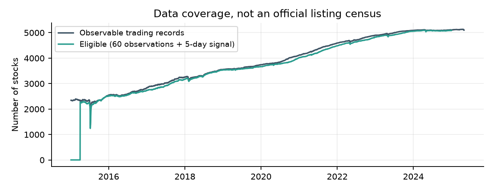
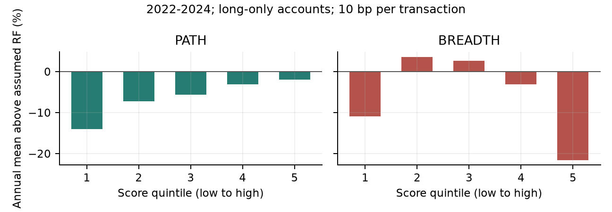
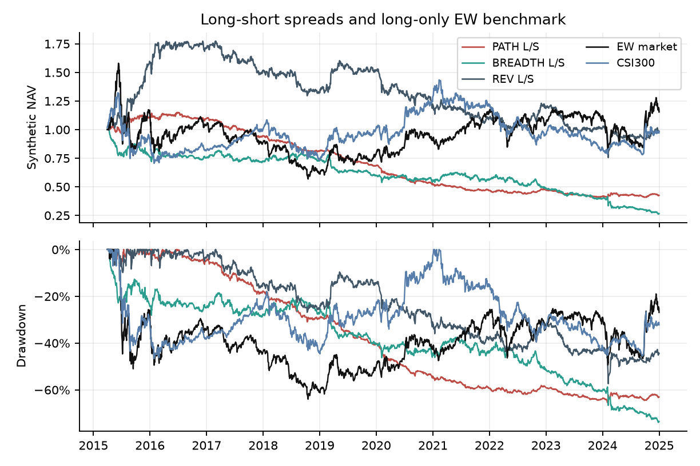
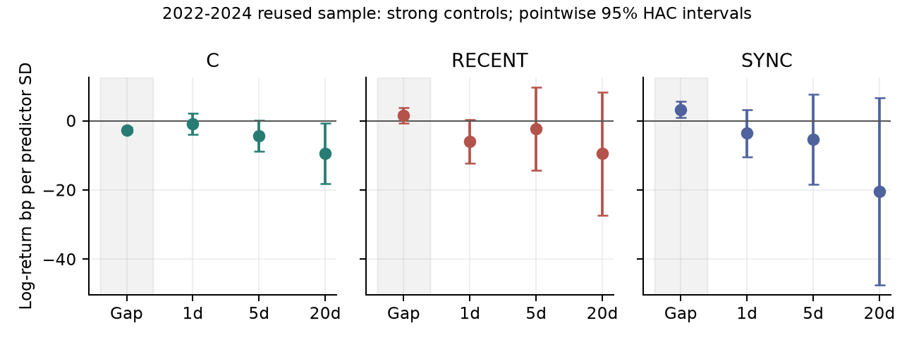

同样的跌幅
不同的过程

A股短期反转的信息增量与执行边界

量化投资策略小组研究报告
Motivation · Setup · Methods · Evidence

摘要

短期反转策略按过去跌幅买入近期输家，但累计跌幅压缩了价格变化的过程。一周内一次下跌、连续下跌和随市场共同下跌，可能对应不同的信息到达和交易压力。我们研究这些差异是否包含普通反转之外的信息，以及这些信息在延迟入场和交易成本下能否转化为净收益。

研究使用F.I.R.E.公开沪深A股日频数据，先按固定方案评估路径集中度PATH和市场广度状态策略BREADTH，再对集中度、损失发生时点和市场同步性做探索性拆解。方法包括全市场五分组、带现金约束的多头账户、合成多空差额、本地风险模型、条件排序、横截面回归、逐年冻结预测，以及固定半量调仓对照。

原检验中，2022-2024年PATH的合成多空年化算术均值从零成本12.45%降至单边10个基点成本后的-2.91%；两项正风险调整收益主假设均未获支持。后续拆解未证明稳定五日预测增量。固定半量调仓使PATH多头的年化算术均值改善1.48个百分点，但复合年收益仍为-2.03%。

研究的实质产出是区分指标的测量内容、增量信息与执行收益，并给出可复核的结果。Alpha指风险模型回归截距，本文使用本地重建的风险因子代理。后续分析重复使用2022-2024数据，均为探索性；2025年1-4月只提供短期扩展证据。

关键词：短期反转；收益路径；市场广度；增量检验；交易成本。

## 目录与研究路线

- [1 动机：累计跌幅遗漏了什么](#section2)
- [2 文献支持问题，也限制解释](#section3)
- [3 数据设定：固定公开行情版本](#section4)
- [4 样本阶段决定证据能说什么](#section5)
- [5 PATH把方向与集中度组合起来](#section6)
- [6 广度是状态，不能单独排序个股](#section7)
- [7 账户模拟只在信号形成后交易](#section8)
- [8 风险模型与收益口径必须一致](#section9)
- [9 本地风险代理与辅助控制](#section10)
- [10 后续方法拆开时间与同步性](#section11)
- [11 标签拆分与逐年冻结预测](#section12)
- [12 原五分组展示排序差异](#section13)
- [13 正Alpha主假设均未获支持](#section14)
- [14 净值曲线展示全期风险](#section15)
- [15 成本与定义分别解释两类失败](#section16)
- [16 强基线与入场时点限定增量](#section17)
- [17 预测与执行是两种不同检验](#section18)
- [18 贡献、边界与可检验的后续工作](#section19)
- [19 复现索引与参考资料](#section20)

第1-3节建立研究问题和样本；第4-11节解释实验设定与方法；第12-17节报告结果；第18-19节讨论贡献、复现和文献。

## 1 动机：累计跌幅遗漏了什么

短期反转投资者需要区分暂时卖压与持续重估。过去五日跌幅相同的两只股票，并不一定具有相同的反弹概率：一次集中的流动性冲击可能随后修复，连续到达的坏消息则可能继续压低价格。仅按累计收益排序会把这些过程放入相近位置。这个压缩是否损失预测信息，是本文的起点。

一个固定总跌幅的例子

| 过程     | 五日日对数收益(%)         |   累计对数收益(%) | 待检验的区别           |
|:-------|:-------------------|------------:|:-----------------|
| A：早期冲击 | -5, 0, 0, 0, 0     |          -5 | 冲击已有四天消化时间       |
| B：近期冲击 | 0, 0, 0, 0, -5     |          -5 | 冲击刚发生，隔夜调整可能尚未结束 |
| C：连续下跌 | -1, -1, -1, -1, -1 |          -5 | 信息逐步到达，或交易压力持续存在 |

这是人为构造的说明例，不是实测收益。三个过程的累计对数收益相同，对应简单累计收益均为exp(-0.05)-1；不能把连续五天简单跌1%与简单跌5%混为严格相同。

市场环境提供第二个维度

同样的个股下跌，既可能出现在普跌日，也可能发生在其他股票上涨时。前者可能包含共同风险、赎回或流动性压力，后者可能包含更强的公司信息成分。两种环境是否改变反转，需要直接检验；“普跌时反转更强”本身并不能推出“非普跌时应该追涨杀跌”。

为什么必须研究净收益

五日信号更新很快，组合换手也可能很高。即使某个过程与后续反弹相关，价格变化也可能在次日开盘入场前完成，或在交易费用后消失。因此研究目标包含三个层次：观察到收益差、证明相对基线的增量、检验执行后的经济价值。每一层都需要不同证据。

核心问题：在控制累计跌幅及常见风险特征后，价格变化的过程与市场环境是否仍能预测后续收益，并在明确的执行规则下保留经济价值？

## 2 文献支持问题，也限制解释

价格路径与市场状态都有已有研究基础。信息连续性研究将渐进的信息到达与投资者注意力联系起来；短期反转分解和流动性供给研究则提示，收益的来源会影响反转及其时间变化。本文把这些启发转成公开A股日频数据上可计算的比较，并不直接复现其机制识别。[1-3]

| 文献线索        | 提供的启发            | 本文检验                  | 解释边界                    |
|:------------|:-----------------|:----------------------|:------------------------|
| 信息到达过程 [1]  | 连续和离散信息可对应不同价格调整 | 五日集中度及发生时点是否超越累计跌幅    | 原文偏重动量；不能直接推出本研究的五日反转方向 |
| 反转来源分解 [2]  | 行业、基本面和残差变化有不同作用 | 使用收益与特征控制，避免把普通反转重新命名 | 没有历史公告/行业标签，不能识别非基本面冲击  |
| 流动性供给状态 [3] | 反转收益可能随市场压力变化    | 广度是否具有条件解释力           | 广度不是流动性压力或恐慌的直接观测       |
| 成本与组合构造 [4] | 交易频率和持仓选择影响净收益   | 固定半量调仓的毛收益/费用分解       | 慢调仓并非原创方法，本文贡献是具体对照与核算  |

竞争性机制必须同时保留

集中下跌可能吸引注意并伴随过度卖出，此时后续反转符合暂时压力的解释；也可能来自公司价值永久下降，此时延续下跌同样合理。渐进下跌既可能是缓慢信息扩散，也可能是持续卖压。价格与成交量只能构造这些机制的代理，无法直接观察投资者的信念、注意力或动机。

科学问题与主检验不是同一件事

科学问题H1关注相近跌幅内的路径差异，H2关注市场广度的条件作用。第一轮为满足全市场排序要求，将它们操作化为PATH和BREADTH策略，并把两个策略的正四因子Alpha作为主检验。策略扩展引入了额外假设；主检验失败后，应返回原问题定位原因，而不是反转策略符号。

## 3 数据设定：固定公开行情版本

数据来自F.I.R.E.公开发布的AStockData.tar.gz。[5] 实际文件覆盖2015-01-05至2025-04-30，共2509个日期、5363列代码。代码前缀筛选后保留5362列沪深A股记录；代码筛选排除的302132.SZ仅出现在2025年，因此不影响2015-2024的原始回测。

| 类别   | 字段                                                       | 用途                  |
|:-----|:---------------------------------------------------------|:--------------------|
| 价格   | open、close                                               | 后复权开盘/收盘，计算信号、估值与标签 |
| 交易活动 | volume、money                                             | 零成交执行检查；非流动性代理      |
| 原价   | close_dr                                                 | 价格特征控制，与复权收益分开      |
| 估值   | market_cap_ashare、circulating_market_cap_ashare、pb_ratio | 规模控制、加权广度、本地风险代理    |
| 核验   | return_adj、turnover_ratio                                | 核对收益单位；记录数据字段       |

实际可观察交易记录与第一轮有效股票数。数据中的历史代码列数不代表每个时点都有相同数量的可交易股票。

第一轮需要累计60次正收盘价观察、有效五日收益以及形成日正成交量；全市场合格股票不足100只时不形成新目标组合。首次合格日期为2015-04-03，固定网格使首次入场为2015-04-10。第二轮额外要求五日窗口内每天有正成交量，故两轮估计对象不完全相同。

审计发现217个代码的最后正价早于原数据末日。缺少官方历史上市退市主表，无法认证无幸存者偏差；“全市场”在本文指文件内符合形成日条件的可观察沪深样本。2025扩展沿用原代码名单，也不等于官方完整总体。

## 4 样本阶段决定证据能说什么

| 阶段      | 时间范围                              | 固定选择                         | 证据身份                    |
|:--------|:----------------------------------|:-----------------------------|:------------------------|
| 第一轮固定方案 | 2015-2020开发；2021验证；2022-2024原固定留出 | 5日窗口、5日调仓、成本10bp；不按收益选参数     | 检验事前写下的两个策略方向           |
| 第二轮机制诊断 | 上述三个时期分列；追加2025年1-4月              | C、RECENT、SYNC；强控制；1/5/20日与缺口 | 2022-2024已查看，全部新增结论为探索性 |
| 执行扩展    | 同样的历史分期及2025短扩展                   | 只增加固定50%调仓，与100%对照           | 检验费用节省与毛收益损失的折衷         |

第一轮方案冻结提交为a5f6d25，规则先于策略结果读取。这里的“原固定留出”表示没有据该段结果挑选当轮参数，仍然是历史回测。第二轮已经知道第一轮结果，不能借助逐年训练或多重检验校正重新获得独立留出的身份。

明确三种基线的不同用途

下表的R5表示过去五日累计对数收益；REV按它的相反数衡量普通反转。

| 基线        | 回答什么问题                 | 口径                      |
|:----------|:-----------------------|:------------------------|
| REV = -R5 | 普通五日反转；检验过程指标是否增加信息    | 同股票池、同调仓和成本             |
| EW        | 有效股票池的等权多头；检查相对持有市场的收益 | 不是风险暴露完全匹配的多空基准         |
| 沪深300价格指数 | 展示大盘行情和回撤背景            | 不含分红、不扣费用，不用于择参或风险模型MKT |

原回测估值序列共2374个交易日，2022-2024为726日。第二轮有483个可用形成日；2022-2024完整五日标签144期，2025仅15期。跨时期的标签终点不计入该时期的第二轮统计。

## 5 PATH把方向与集中度组合起来

以股票i在t日的后复权收盘价P为输入，定义日对数收益r和过去五日累计对数收益R5。负收益部分l和正收益部分g分别记录下跌和上涨幅度；零值不贡献其分母。

`r(i,t) = log[P(i,t) / P(i,t-1)]; R5(i,t) = sum(k=0..4) r(i,t-k)`

`l(i,s) = max[-r(i,s), 0]; g(i,s) = max[r(i,s), 0]`

`C_minus = max(l) / sum(l); C_plus = max(g) / sum(g)`

`PATH = C_minus if R5 < 0; PATH = -C_plus if R5 > 0; PATH = 0 if R5 = 0`

在下跌样本中，五天等量负收益对应集中度0.2；只有一天产生负收益对应1。全市场版本对上涨股票使用负号，再按分数从低到高分Q1至Q5。Q1是最低分组，Q5是最高分组，通常分别包含集中上涨和集中下跌股票；Q5-Q1同时带有收益方向与集中度差异。

用两种控制返回原科学问题

第一种控制只保留R5<0的股票，把累计跌幅分为三组，并与集中度五组独立交叉。比较每个累计跌幅组内的高减低集中度收益，可以减轻普通反转的混入，但三组划分不能实现精确匹配。

第二种控制在形成日做横截面回归，加入R5、最后一天收益、20日波动、对数市值、对数原价和Amihud非流动性代理。Amihud衡量单位成交额对应的价格变化。解释变量在标签可观测回归样本内按1%/99%缩尾、标准化；每个日期得到PATH系数，再检验其时间平均。

`First-round event label: y(i,t,5) = O(i,t+6) / O(i,t+1) - 1`

O是后复权开盘价。第一轮双重排序、PATH回归和广度条件检验使用上述五日简单收益标签，未实施成交、现金或费用约束。它与账户净值收益不同，也与二轮对数事件标签不同。

替代代理与测量局限

`HHI_minus = sum(l^2) / [sum(l)]^2`

预设的HHI替代版本使用负收益份额平方和，并对上涨样本做同样对称处理。最大份额和HHI都忽略五天的时间顺序：任意交换日期，其数值不变。这是指标定义的性质，不是数据检验结果；第二轮据此单独加入损失发生时点。

## 6 广度是状态，不能单独排序个股

每日下跌广度b是当日有效交易股票中负收益股票的比例，B是过去五日b的均值。B对同一天所有股票相同，所以直接把B当作个股分数会全部同分。第一轮使用它调节反转信号，并以滞后流通市值加权广度作为替代代理。

`b(t) = count(valid stocks with r < 0) / count(valid stocks); B(t) = mean(b(t-4:t))`

`REV(i,t) = -R5(i,t); BREADTH(i,t) = [2B(t)-1] * REV(i,t)`

| 市场状态    | 排序运算   | 实际含义                 |
|:--------|:-------|:---------------------|
| B > 0.5 | 正数乘REV | 与REV同序：做反转           |
| B < 0.5 | 负数乘REV | 与REV反序：做动量           |
| B = 0.5 | 所有分数为0 | 平均秩使股票同分，不能声称仍有五个等大组 |

这个公式实现的是反转/动量状态切换。它没有在同一状态下提供新个股信息，也没有根据B的大小连续调整组合仓位。以五分组等权交易时，正的共同倍数大小不会改变选股。

条件调节问题需要单独检验

`S_REV(t) = a + gamma*B(t) + d1*market_R5(t) + d2*market_vol20(t) + error(t)`

S_REV是形成后五日普通反转组的毛收益差。market_R5和market_vol20分别为可观察合格股票等权日对数收益的五日和、20日标准差。该时间序列回归检验广度的条件关系，避免在同日横截面同时放入R5和BREADTH造成完全线性相关。事后翻转BREADTH方向不能验证原假设。

该设计使科学问题与策略实现分开：我们既公布原始切换策略的结果，也检验“广度是否改变反转”这个更一般的问题。

## 7 账户模拟只在信号形成后交易

| 步骤     | 账户动作                             | 信息与限制              |
|:-------|:---------------------------------|:-------------------|
| t日收盘后  | 计算信号与形成日股票池；用平均百分位秩分Q1-Q5，各组等权目标 | 只用t及以前数据；同分不按代码强拆  |
| t+1日开盘 | 按实际可成交价格先卖后买；现金不足时缩减买入           | 非正/缺失开盘或全天零成交不成交   |
| 价格约束   | 相对上次正收盘，开盘跳涨>=9.5%不买；跳跌<=-9.5%不卖 | 统一保守代理，不是精确ST/板块限制 |
| 未成交    | 拒绝买入留现金，拒绝卖出保留旧持仓                | 不据未来结果重新分配入选权重     |
| 逐日收盘   | 现金加股票市值形成净值；缺失价沿用最后正价            | 记录滞价持仓，不假设其已经卖出    |

每五个交易日调仓一次，调仓日不再卖出当天新买的份额。账户使用后复权价格和分数股，缺少整手、市场冲击容量和开盘排队模拟。全天正成交量仅排除全天无成交，不能保证开盘订单可执行。

费用按实际成交额扣除

`fee_cash(t) = c * [buy_notional(t) + sell_notional(t)]; c = 10/10000 = 0.001`

`daily_return(t) = NAV_close(t) / NAV_close(t-1) - 1`

主情景单边10bp，1bp=0.01%，买和卖各计一次。0bp、30bp为预先固定敏感性，不代表历史真实税费。换手分母使用调仓时开盘净值，费用率分母使用上日收盘净值，两者存在小的口径差异。

多空差额的适用边界

`fee_Q1(t) = fee_cash_Q1(t) / NAV_Q1(t-1)`

`LS_net(t) = Q5_net(t) - Q1_net(t) - 2*fee_Q1(t)`

Q1_net已经减过费用，直接相减会把Q1费用加回，所以公式再减两次Q1费用，使两腿各承担一次交易成本。它是按100%多头减100%空头定义的合成收益差；Q1执行仍来自多头账户，没有真实空头开仓/回补方向、借券与融资约束。后续执行改进因此只比较含现金与成交额核算的多头账户。

## 8 风险模型与收益口径必须一致

我们区分年化算术均值、复合年收益和风险调整Alpha。算术均值适合费用加减分解；复合年收益反映净值累积；Alpha检验在给定风险模型下是否存在截距。三者不能互相替代，尤其是波动较大的多头组合。

`annual_mean = 252 * mean(daily_return)`

`CAGR = [product(1 + daily_return)]^(252/N) - 1`

`Sharpe = sqrt(252) * mean(excess_daily_return) / std(excess_daily_return)`

`MDD = min_t [NAV(t) / max(1, NAV(1), ..., NAV(t)) - 1]`

CAGR即复合年增长率；MDD为最大回撤。多头超额收益减去假设无风险收益，多空差额不再扣一次无风险收益。月度组合收益由日收益复利合成，月度回归截距乘12得到年化Alpha。

| 模型                   | 月度回归右侧                                                    |
|:---------------------|:----------------------------------------------------------|
| 资本资产定价模型 CAPM        | alpha + beta_M*MKT                                        |
| Fama-French三因子结构 FF3 | alpha + beta_M*MKT + beta_S*SMB + beta_H*HML              |
| Carhart四因子结构         | alpha + beta_M*MKT + beta_S*SMB + beta_H*HML + beta_U*MOM |

MKT是市场超额收益，SMB是小盘减大盘，HML是高账面市值比减低账面市值比，MOM是动量赢家减输家；beta是各风险暴露系数。本文使用固定规则重建的本地FF式代理，未取得并核验官方中国因子序列；模型结构已运行不等于官方标准因子检验已完成。

月度Alpha使用HAC(3)标准误，日均收益使用HAC(10)。HAC表示对异方差和序列相关作调整。两项主检验使用双侧p值进行Holm校正，只有Alpha为正且校正后p<0.05才支持原正Alpha假设。显著负Alpha是反对证据。

## 9 本地风险代理与辅助控制

| 代理      | 构造                                          | 边界                    |
|:--------|:--------------------------------------------|:----------------------|
| RF      | 固定年化1.5%，日复利换算；另做0%和3%敏感性                   | 是假设，不是观测到的历史国债曲线      |
| MKT     | 前一日市值加权可观察股票收益，减RF                          | 与沪深300展示指数不同          |
| SMB/HML | 6月规模中位数；上年12月正PB倒数的30/70分位；2x3组合7月至次年6月固定标签 | 账面信息PIT未经认证；PB倒数为价值代理 |
| MOM     | 月末按过去252至21交易日收益的30/70分位，结合规模两组；下一月持有       | 赢家/输家尾部组合，不含交易费用      |
| 共同月份    | 价值标签首个可用年度为2016年7月；全样本三模型均使用相同102个月         | 2022-2024比较含36个月      |

PIT是point-in-time，即使用当时已经公开而非后续修订的信息。滞后PB快照不自动认证基础数据的公告可得时间。各风险组合每日按前一日市值加权，日收益复利聚合成月度解释变量；风险组合本身不扣费。

辅助控制的设计理由

规模、原价和Amihud非流动性可能同时影响信号分布与交易难度。第一轮分别将这些特征分三组，再与因子五组独立交叉，检查表现是否集中于某类股票。Amihud代理使用过去20日绝对日对数收益除以成交额的均值，较大值表示单位成交额伴随较大价格变化。

替代proxy、子时期、RF敏感性和控制排序均保留原预设输出。它们用于检查解释是否依赖某一种度量，不通过选取最有利表格替代两个主检验。全部明细CSV随项目公开，文中只整理与主问题相关的结果。

## 10 后续方法拆开时间与同步性

二轮机制分析只保留过去五日累计对数收益为负的股票，并使用同一五日形成网格。它把价格过程拆成集中度C、损失发生时点RECENT和市场同步性SYNC三个可解释特征，避免一个分数同时混合多个机制。

`j = 0,...,4 (oldest to newest); w(i,j) = max[-r(i,j),0] / sum_j max[-r(i,j),0]`

`C(i,t) = max_j w(i,j); RECENT(i,t) = sum_j w(i,j)*j/4`

`SYNC(i,t) = sum_j w(i,j)*[b_minus_i(j) - mean_j b_minus_i(j)]`

b_minus_i是剔除股票i自身后的每日下跌比例。剔除自身避免直接把该股票的跌幅符号计入市场状态；减去五日均值，突出损失发生日期与市场下跌日期的对齐。高SYNC表示损失更多发生在下跌广度相对较高的日子，并不直接说明公司信息或共同风险的来源。

| 说明例     |   C |   RECENT | 比较意义        |
|:--------|----:|---------:|:------------|
| 五日等量下跌  | 0.2 |      0.5 | 集中度低，时间重心居中 |
| 仅最早一天损失 | 1   |      0   | 集中但较早       |
| 仅最近一天损失 | 1   |      1   | 集中且较新       |

条件回归与近似匹配

`y(i,t,h) = a(t,h) + beta_C*C_std + beta_R*RECENT_std + beta_S*SYNC_std + controls + error`

弱控制包括R5、R1、20日波动、对数市值、对数原价和非流动性；强控制用五个逐日收益替换R5/R1。三个过程特征同时进入模型，以检验相对逐日收益线性基线的增量。形成日解释变量先按1%/99%缩尾，再标准化；标准化样本不根据未来标签可用性改变。

我们还将每个特征对强控制和另两个特征残差化，再在R5十分位内做五分组，各累计跌幅组等权。残差表示线性控制尚未解释的部分；这种分组仍是近似条件比较，不提供严格匹配或因果识别。

## 11 标签拆分与逐年冻结预测

入场前后标签回答不同问题。令O为后复权开盘价，信号在t日收盘后可知；完整五日信号不能用来假设自己已经在t日收盘成交。二轮使用对数价格比作为事件标签，第一轮账户则使用净值简单收益，两种数值分别标注。

| 标签        | 定义                  | 解释                |
|:----------|:--------------------|:------------------|
| 入场前缺口 gap | log[O(t+1)/P(t)]    | 信号形成后、原策略成交前的价格变化 |
| 入场后1日     | log[O(t+2)/O(t+1)]  | 短期调整              |
| 入场后5日     | log[O(t+6)/O(t+1)]  | 与五日策略尺度对应         |
| 入场后20日    | log[O(t+21)/O(t+1)] | 考察效应是否延续；相邻事件会重叠  |

事件标签没有买卖成交、现金和成本约束，不能作为可交易回测。未来价格缺失只使该标签不可观测，不回改形成分组；跨期标签不进入该期统计。1/5日及缺口系数均值用HAC(2)，20日用HAC(4)处理重叠依赖。2025样本不足20期，不报告对应显著性。

预测比较不利用当年标签更新系数

基线模型使用五个逐日收益及四项控制，增强模型再加入C、RECENT、SYNC。每年年初，分别取此前完整标签的历史横截面回归系数均值；至少需要100个历史形成日，年内冻结。预测当日只读取已知特征，并用形成日横截面标准化。

秩IC是预测分数与未来收益在同日股票横截面上的Spearman秩相关。我们比较两模型的平均IC及逐日配对IC差，同时比较去均值后的均方预测误差MSE。截距不影响排序，MSE比较也去除同日均值。该逐年检验避免训练函数读取未来标签，但不能消除研究方案利用已查看结果制定的选择风险。

主要探索性比较为强控制下三个五日系数，做Holm(3)；另公开两种控制、四种标签、三个特征合计24项的Holm调整。多重校正约束当前检验集合，不抵消跨轮研究选择。

## 12 原五分组展示排序差异

2022-2024各五分组多头账户、单边10bp。图为相对固定RF假设的年化算术超额收益；它不等于相对市场基准收益或Alpha。

| 组合         | 年化均值    | 超RF     | 超EW     | 四因子Alpha   |
|:-----------|:--------|:--------|:--------|:-----------|
| PATH Q1    | -12.50% | -13.99% | -15.47% | -13.60%    |
| PATH Q2    | -5.79%  | -7.28%  | -8.76%  | -7.55%     |
| PATH Q3    | -4.12%  | -5.61%  | -7.09%  | -6.97%     |
| PATH Q4    | -1.64%  | -3.13%  | -4.61%  | -0.83%     |
| PATH Q5    | -0.44%  | -1.92%  | -3.40%  | 1.42%      |
| BREADTH Q1 | -9.47%  | -10.96% | -12.44% | -4.70%     |
| BREADTH Q2 | 5.07%   | 3.58%   | 2.10%   | 7.17%      |
| BREADTH Q3 | 4.09%   | 2.60%   | 1.12%   | 1.83%      |
| BREADTH Q4 | -1.64%  | -3.13%  | -4.61%  | -6.22%     |
| BREADTH Q5 | -20.05% | -21.54% | -23.02% | -23.16%    |

表中Alpha全部来自本地FF式代理。PATH各组收益随分数总体改善，但Q5年化均值仍为负；BREADTH没有出现预期的从Q1到Q5上升关系。单独观察分组差异不能证明新信息，也不能直接用两份净多头账户相减得到含正确双腿成本的多空收益。

## 13 正Alpha主假设均未获支持

| 策略      | 本地代理模型   | 年化Alpha   |   HAC t | 原始p    | 主检验Holm p   |
|:--------|:---------|:----------|--------:|:-------|:------------|
| PATH    | CAPM     | -2.38%    |   -0.5  | 0.615  | NA          |
| PATH    | FF3      | -0.65%    |   -0.09 | 0.925  | NA          |
| PATH    | Carhart4 | 0.67%     |    0.1  | 0.921  | 0.921       |
| BREADTH | CAPM     | -24.60%   |   -4.39 | <0.001 | NA          |
| BREADTH | FF3      | -26.45%   |   -3.01 | 0.003  | NA          |
| BREADTH | Carhart4 | -27.92%   |   -3.27 | 0.001  | 0.002       |

三模型均使用2022-01至2024-12的36个月。PATH四因子截距接近零且无统计支持；BREADTH的四因子Alpha为负，校正后p较小也不支持正Alpha假设。不同模型的截距变化不能作为挑选最有利风险模型的依据。

| 收益序列 / 成本bp     | 年化均值    | CAGR    |   Sharpe | 最大回撤    |
|:----------------|:--------|:--------|---------:|:--------|
| PATH_LS / 0     | 12.45%  | 12.88%  |     1.52 | -5.87%  |
| PATH_LS / 10    | -2.91%  | -3.20%  |    -0.35 | -17.55% |
| BREADTH_LS / 0  | -10.71% | -11.40% |    -0.64 | -39.03% |
| BREADTH_LS / 10 | -24.51% | -22.80% |    -1.5  | -56.82% |
| REV_LS / 10     | -2.34%  | -3.68%  |    -0.14 | -38.58% |
| EW / 10         | 2.97%   | -0.22%  |     0.06 | -32.31% |
| 沪深300价格指数       | -6.15%  | -7.59%  |    -0.41 | -36.05% |

PATH零成本合成差额的表现优于扣费结果，但多空、等权多头和价格指数风险敞口不同，表中基准比较仅用于理解收益背景。股指无分红、无交易成本，也没有用于模型或策略选择。

## 14 净值曲线展示全期风险

2015-04-01至2024-12-31。PATH、BREADTH及REV为单边10bp的合成多空差额净值；EW为同成本等权多头，CSI300为无费用、无分红的价格指数。下图显示各自回撤。

全期曲线展示信号在不同市场阶段的累积表现，不能替代原固定留出期的主检验。多空差额和多头市场资产的风险敞口不同；图中的“跑赢指数”不自动意味着风险调整后的Alpha。

合成多空曲线按日收益差复利累积，用于研究排序差额的时间路径。它不是有融资、保证金和实际融券限制的多空账户净值。原始PATH与BREADTH各五分组的完整净值图同时保存在reports/figures/path_quintiles.png和breadth_quintiles.png。

## 15 成本与定义分别解释两类失败

PATH：高换手把毛收益压过零点

| 分解项         | 2022-2024   |
|:------------|:------------|
| 零成本合成多空年化均值 | 12.4500%    |
| 扣Q5实际年化费用   | -7.7892个百分点 |
| 扣Q1实际年化费用   | -7.4903个百分点 |
| 两种成本下持仓路径差异 | -0.0835个百分点 |
| 10bp后年化均值   | -2.9130%    |

两腿分别按各自账户净值标准化后的年化成交额之和约153倍，其中Q5约78倍、Q1约75倍。按0.1%收费，费用负担约15.28个百分点。固定10bp账户持仓的线性盈亏平衡成本约8.09bp，仅为诊断值，未包含借券等额外费用，不能据此选用更低费用宣称盈利。

BREADTH：零成本已经为负

| 形成时状态   |   事件数 | 普通REV五日毛差额   | 切换规则方向下差额   |
|:--------|------:|:-------------|:------------|
| B<=0.5  |    72 | 0.54%        | -0.54%      |
| B>0.5   |    72 | -0.02%       | -0.02%      |

在非普跌状态，普通反转的五日平均毛差额为正，原公式却强制反向。原BREADTH账户的零成本年化均值已为-10.71%，所以失败不能全归于手续费。上表是事件收益诊断，不是实际账户收益的精确分解。广度条件回归p=0.907，也没有支持独立调节关系。

主结论：PATH的执行费用足以改变组合收益正负；BREADTH还包含结果未支持的状态切换假设。两者都需要继续检验相对普通反转的增量。

## 16 强基线与入场时点限定增量

第一轮条件证据与二轮控制相互补充

原全市场PATH回归控制R5、R1等后，五日系数为-2.16简单收益bp/标准差，p=0.255。在下跌股票内按累计跌幅三组交叉排序，三组高减低集中度的p值分别为0.051、0.537、0.139；单个接近阈值的子组不能代替主假设。

| 二轮特征   |   5日系数(bp/SD) |   原始p |   Holm(3)p |
|:-------|--------------:|------:|-----------:|
| C      |         -4.28 | 0.061 |      0.184 |
| RECENT |         -2.31 | 0.705 |      0.841 |
| SYNC   |         -5.33 | 0.421 |      0.841 |

已查看的2022-2024样本；强控制后各期限系数。单位为对数收益bp/标准差，误差线为逐项95% HAC区间；显著性另看多重校正。

集中度与入场前负缺口的系数为-2.66bp/标准差，24项Holm校正p=4.8e-12。条件分组的高减低缺口为-3.54bp，但入场后五日差为+1.69bp，p=0.748。

高集中度与次日低开存在关联，但原策略到开盘才成交，不能把缺口当作已捕获收益。这一结果也不能解释为原PATH全部毛收益发生于开盘前：样本、控制和收益定义均不同。

## 17 预测与执行是两种不同检验

逐年冻结预测没有显示稳定改善

| 预测期        |   基线秩IC |   增强秩IC |    配对差值 | HAC p   |   日期数 |
|:-----------|--------:|--------:|--------:|:--------|------:|
| 2018-2020  |  0.0552 |  0.0574 |  0.0022 | 0.291   |   144 |
| 2021       |  0.0696 |  0.0728 |  0.0032 | 0.443   |    48 |
| 2022-2024  |  0.0635 |  0.0585 | -0.0049 | 0.085   |   144 |
| 2025.01-04 |  0.0295 |  0.0307 |  0.0012 | NA      |    15 |

2022-2024的IC差为负，p=0.085；证据不支持提升，也不能在5%阈值下证明新增特征有害。2025短期IC略升，但只有15个完整五日观察，不足以宣称稳定复现。这里的2018-2020始点来自至少100个历史形成日的训练要求。

固定半量调仓量化了成本折衷

`desired_half_shares = current_shares + 0.5*(desired_full_shares - current_shares)`

HALF只完成当前份额到完整目标份额距离的50%，仍先卖后买并支付实际费用；FULL完成100%。两者都使用原PATH或REV的Q5多头，开始时HALF可能持有更多现金。我们没有搜索最优比例，也没有把已算收益简单乘一半。

| 多头账户      | 年化均值   | CAGR    | 年化费用   |   年换手倍数 |
|:----------|:-------|:--------|:-------|--------:|
| PATH_FULL | -0.44% | -3.57%  | 7.79%  |   77.96 |
| PATH_HALF | 1.04%  | -2.03%  | 3.87%  |   38.75 |
| REV_FULL  | -9.40% | -12.41% | 7.43%  |   74.37 |
| REV_HALF  | -4.56% | -7.66%  | 3.68%  |   36.84 |

PATH省费用3.92个百分点，同时损失实际持仓毛收益2.44个百分点，净改善1.48个百分点。HALF年化均值为正，但CAGR仍为-2.03%；执行改善尚未带来正复合收益，也不是市场中性Alpha。

## 18 贡献、边界与可检验的后续工作

本研究完成的三项实质工作

| 贡献   | 可以支持的主张                      | 证据                      |
|:-----|:-----------------------------|:------------------------|
| 测量辨析 | 证明集中度对日期排列不变；证明共同广度倍数只改变排序方向 | 第5-6节；120种排列及共同标量单元测试   |
| 增量定位 | 加入时点与同步性，比较强基线、条件分组和入场时点     | 第10-11、16-17节；全部24项检验公开 |
| 执行核算 | 对齐费用口径；量化固定慢调仓的费用节省和毛收益代价    | 第7、15、17节；账户对账与恒等式验证    |

这些结果支持一项课程层面的测量与执行研究，未支持发现两个可交易新Alpha，也没有证明所有价格路径或市场状态指标都无用。已有文献讨论了路径信息与交易成本；本文的差异在于当前A股公开样本下的定义审计、成套对照和证据分层。[1-4]

风险比较仍存在不确定性

PATH零成本合成差额的Sharpe为1.52，REV为0.71；同步20日移动块、2000次bootstrap的差值95%区间为[-0.07, 1.89]，跨越零。较高的点估计尚不能证明稳定风险优势；开发期还是REV更高。

会影响解释的边界

数据缺少官方历史上市退市主表和公告可得时点认证。停牌/消失后的旧价延续可能高估资产价值；原账户中滞价资金最高占比在部分组合达到两位数。统一9.5%成交代理、分数股、无容量约束和合成空头均限制可执行性。固定10bp并非历史费率估计，本地FF式Alpha也不能替代官方因子结论。

下一步先增加识别信息

更强的后续设计需要历史公告和行业标签，事先区分信息事件与非事件下跌，在相近跌幅内比较过程特征，并用新的时间段验证。当前价量结果无法识别恐慌或流动性冲击的因果效应。在新数据落实前，本轮不再翻转因子符号、搜索窗口或挑选调仓比例。

## 19 复现索引与参考资料

仓库保留原始报告、二轮补充报告和本整合报告。原始行情不随代码再分发；聚合结果、图和实现脚本可从仓库取得。本报告只整合已计算证据，没有新增回测或改变原检验。

| 内容      | 路径                                                                                          |
|:--------|:--------------------------------------------------------------------------------------------|
| 原始方案与数据 | PROTOCOL.md；PROXY_MODELS.md；run_study.py；src/data.py                                        |
| 账户与统计   | src/backtest.py；src/statistics.py；src/risk.py                                               |
| 后续方法    | EXPLORATION_PROTOCOL.md；EXECUTION_EXTENSION.md；run_mechanisms.py；run_execution_extension.py |
| 聚合结果    | results/；results/exploration/                                                               |
| 报告生成与校验 | build_integrated_report.py；verify_integrated_report.py；RUN.md                               |

本报告绑定config/integrated_report_snapshot.json中的固定证据版本；来源改变时生成器拒绝构建，须另行审阅新版本。已有结果时运行python build_integrated_report.py，再运行python verify_integrated_report.py。下载与计算见RUN.md。27项单元测试、3份原账户零误差对账及费用恒等式提供实现核验。

[[1] Da, Gurun & Warachka. Frog in the Pan: Continuous Information and Momentum. 2011工作论文版本。](https://business.uq.edu.au/sites/default/files/events/files/mitch-warachka-paper.pdf)

[[2] Da, Liu & Schaumburg. Decomposing Short-Term Return Reversal. FRBNY Staff Report 513, 2011。](https://www.newyorkfed.org/research/staff_reports/sr513.html)

[[3] Nagel. Evaporating Liquidity. NBER Working Paper 17653, 2011。](https://www.nber.org/system/files/working_papers/w17653/w17653.pdf)

[[4] de Groot, Huij & Zhou. Another Look at Trading Costs and Short-Term Reversal Profits. Journal of Banking & Finance, 36(2), 2012。](https://repub.eur.nl/pub/25718/AnotherLook_2011.pdf)

[[5] F.I.R.E. A-Share Data：字段定义与公开数据范围。实际样本以本地文件审计为准。](https://fire-institute.github.io/fire/data/a-share/)

[[6] 本项目代码与聚合证据。](https://github.com/yks23/Quant-Project)

归档SHA-256：38c40f84bb0a7f269b5775d8a80b712cf81138593f5bfb1bae0e91aff3e2228b。当前报告所用CSV的逐文件摘要写入results/integrated_report_manifest.json，报告生成不会覆盖前两份PDF。
