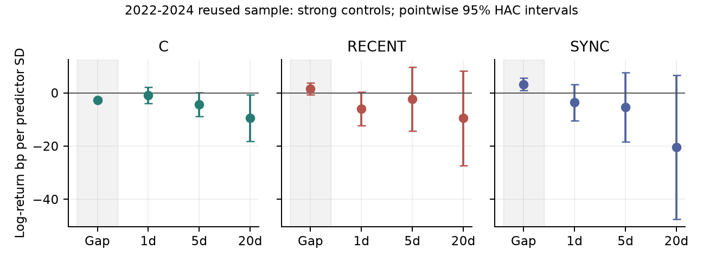
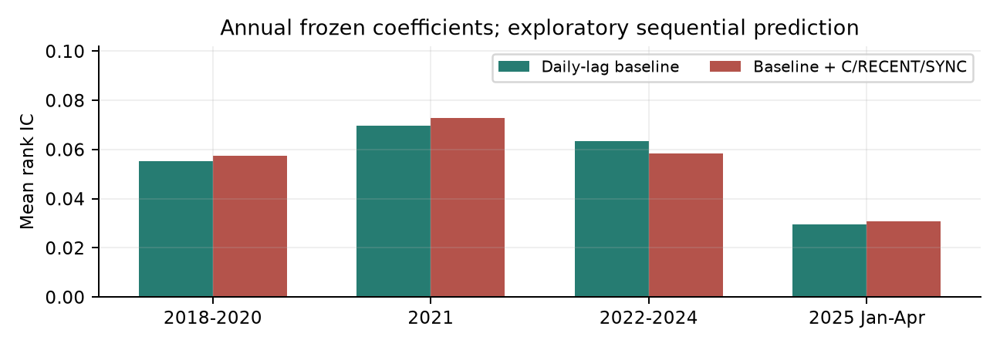
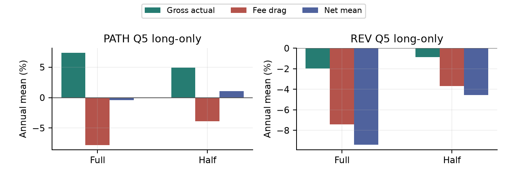

从收益形态
到可捕获收益

下跌路径、市场广度与短期反转：二轮机制诊断及固定半量调仓对照

这轮工作的增量不是把失败因子调成正收益，而是区分三个不同命题：指标测到了什么，是否增加可预测信息，以及交易规则能保留多少收益。原始因子报告及结果保持不变。

| 证据层次   | 结果与贡献                                            |
|:-------|:-------------------------------------------------|
| 测量     | 集中度对120种五日顺序排列不变；加入时点和市场同步性，检验被原指标遗漏的信息。         |
| 信息     | 2022-2024强控制下，三个5日增量均未通过Holm校正；集中度与入场前负缺口存在关联。   |
| 执行     | PATH多头半量调仓省费用3.92个百分点、损失毛收益2.44个百分点，净改善1.48个百分点。 |

重要边界：2022-2024已经被查看，新增结果是探索性；2025年1-4月只有15个完整五日观察。没有证明新的可交易Alpha。不能将正的年化算术均值误称为正的复合收益。

检索目录

- [1 先拆开集中度、发生时点与市场同步性](#section1)
- [2 最清楚的关联出现在入场之前](#section2)
- [3 新特征没有稳定改善逐年冻结的预测](#section3)
- [4 少交易能改善净收益，但不能保证赚钱](#section4)
- [5 风险改善也需要独立证据](#section5)
- [6 pre应围绕可检验的主张展开](#section6)
- [7 复现、文献与下一步的停止规则](#section7)

## 1 先拆开集中度、发生时点与市场同步性

原PATH的集中度没有时间顺序信息。某股票在周一跌5%、其余四天不动，与在周五跌5%、此前四天不动，得到相同集中度1。它能区分一次大跌与分散下跌，但不能区分冲击的新旧。

令五个交易日从早到晚编号j=0,...,4，负收益l_j=max(-r_j,0)，损失权重w_j=l_j/sum(l)。只研究R5<0股票，避免全市场多空把路径与涨跌方向混合。

| 定义                                    | 含义                                      |
|:--------------------------------------|:----------------------------------------|
| C = max(w_j)                          | 最大单日负收益占比；越高越集中。                        |
| RECENT = sum(w_j*j/4)                 | 损失时点；越大表示损失越靠近形成日。                      |
| SYNC = sum(w_j*(b_-i,j - mean(b_-i))) | 损失与下跌广度的时间对齐；剔除自身，减掉五日共同水平，不做反转/动量强制切换。 |

SYNC不是原BREADTH的换符号版本。原BREADTH用当日共同标量乘REV，同一天只改变排序方向；新指标利用每只股票在不同日期损失权重的差异。新指标也可能只是现有收益信息的非线性重写，必须接受基线控制。

把最强的简单解释放进基线

弱控制包含R5、R1、波动、市值、原价和非流动性；强控制把R5/R1换成过去五个逐日收益。C、RECENT、SYNC同时进入回归。解释变量形成日1%/99%缩尾并标准化，未来收益不缩尾。

另在R5十分位内对残差化特征做五分组，各R5组等权。这是近似条件比较，不是严格匹配或因果识别：例如C的两端组平均R5仍相差约0.20个百分点。

相关的路径信息与反转分解问题已有文献。这里的课程贡献是测量辨析和验证链，不是宣称首次提出价格路径或市场状态。

## 2 最清楚的关联出现在入场之前

误差线是逐项95% HAC区间，不是同时置信区间；显著性判断另看Holm校正。Gap为形成收盘至次日开盘，其他为次日开盘起算，单位为对数收益bp/解释变量一个横截面标准差。

| 强控制5日标签     |   系数(bp/SD) |   原始p |   Holm(3)p |
|:------------|------------:|------:|-----------:|
| 集中度 C       |       -4.28 | 0.061 |      0.184 |
| 损失时点 RECENT |       -2.31 | 0.705 |      0.841 |
| 市场同步性 SYNC  |       -5.33 | 0.421 |      0.841 |

集中度的入场前系数为-2.66bp/SD，t=-7.35，24项Holm校正p=4.8e-12。高集中度与次日低开相关，而不是集中下跌后必然马上反弹。

条件五分组的高减低缺口为-3.54bp，12项Holm校正p=1.1e-05；但对应入场后5日高减低为+1.69bp，p=0.748，未得到可捕获增量的支持。

不能将这段缺口记为策略已赚收益：完整收盘信号算出后，原策略到次日开盘才成交。这也不证明原PATH所有毛收益发生在开盘前；两者样本和统计量不同。

## 3 新特征没有稳定改善逐年冻结的预测

每年只用此前完整标签的历史横截面系数均值预测，年内不重新拟合。至少100个历史形成日，故图中开发期预测从2018年开始；这不消除研究方案事后制定的影响。

| 时期         |   基线IC |   增加特征IC |      差值 | 配对HAC p   |   形成日数 |
|:-----------|-------:|---------:|--------:|:----------|-------:|
| 2018-2020  | 0.0552 |   0.0574 |  0.0022 | 0.291     |    144 |
| 2021       | 0.0696 |   0.0728 |  0.0032 | 0.443     |     48 |
| 2022-2024  | 0.0635 |   0.0585 | -0.0049 | 0.085     |    144 |
| 2025.01-04 | 0.0295 |   0.0307 |  0.0012 | NA        |     15 |

2022-2024平均秩IC由0.0635降到0.0585，配对差值p=0.085。证据不支持预测提升，但也不能声称在5%水平证明新特征有害。相对基线的去均值MSE变化同样没有显示改善。

2025短期扩展的IC略升约0.0012，但仅15个五日标签，程序不输出不足20期的显著性检验。2025的集中度仍与负缺口相关，方向一致只能作为短期观察，不能包装成长期复现成功。

覆盖审计：5日标签合计形成934,649个股票-日期观察，其中934,635个有正价终点。分组在形成时固定，缺失标签不用于事前删除股票；未来正报价也不等于能成交。

## 4 少交易能改善净收益，但不能保证赚钱

固定HALF规则每五日只完成当前份额到原始目标份额距离的50%。只测试这一个替代参数，仍先卖后买并支付实际交易费用。采用PATH/REV的Q5多头现金账户，避免将合成空头当作可执行融券。

2022-2024、单边10bp假设。毛收益来自对应10bp账户的净日收益加实际费用，不把不同成本下的持仓路径混合；图中年化均值不是CAGR。

| 多头组合      | 年化均值   | 复合年收益   | 年化费用   |   年换手倍数 |
|:----------|:-------|:--------|:-------|--------:|
| PATH_FULL | -0.44% | -3.57%  | 7.79%  |   77.96 |
| PATH_HALF | 1.04%  | -2.03%  | 3.87%  |   38.75 |
| REV_FULL  | -9.40% | -12.41% | 7.43%  |   74.37 |
| REV_HALF  | -4.56% | -7.66%  | 3.68%  |   36.84 |

PATH：实际费用少3.92个百分点，但实际持仓毛收益少2.44个百分点，净改善1.48个百分点。换手从77.96降到38.75倍。

半量调仓后的PATH年化算术均值为+1.04%，但复合年收益仍为-2.03%，扣除假设无风险收益的Sharpe仍为负。不能使用第一列的正数宣称策略已盈利。风险敞口和股票数也随慢调仓改变，净改善不是市场中性Alpha。

## 5 风险改善也需要独立证据

原PATH零成本多空差额在2022-2024的Sharpe高于REV，这比只比较均值提供了不同视角。为检验其不确定性，对两序列采用同步20日移动块bootstrap，2000次、固定随机种子，保留时间依赖。

| 时期        |   PATH Sharpe |   REV Sharpe |   观察差值 | 差值95%区间        |
|:----------|--------------:|-------------:|-------:|:---------------|
| 2018-2020 |          0.5  |         1.39 |  -0.89 | [-1.68, -0.14] |
| 2021      |          0.47 |         0.35 |   0.12 | [-0.72, 1.62]  |
| 2022-2024 |          1.52 |         0.71 |   0.82 | [-0.07, 1.89]  |

2022-2024观察差值约+0.82，但区间跨零；2015-2020反而是REV更高。不能把一段样本的高Sharpe描述为稳定风险优势。这些仍是零成本合成多空差额，不是修复借券、融券约束后的可执行策略。

哪些结论能讲，哪些不能讲

| 边界   | 内容                                                          |
|:-----|:------------------------------------------------------------|
| 能讲   | 集中度忽略顺序；更强控制后五日增量未证实；集中度与负缺口相关；固定慢调仓量化了毛收益和费用的折衷。           |
| 不能讲  | 首次发现路径Alpha；用价格数据证明恐慌；正算术均值等于盈利；2025短样本证明稳定；本地FF代理等于官方标准因子。 |

公开行情没有官方上市退市主表、公告/行业历史标签和借券可得性。原执行模型以9.5%跳幅近似涨跌停，停牌/消失持仓沿用旧报价。新增多头试验中滞价持仓仍可达到两位数比例，收益可能受估值偏差影响。

## 6 pre应围绕可检验的主张展开

建议标题

同样的跌幅，不同的过程：A股短期反转的信息增量与执行边界

| 页面      | 主张与展示                                                     |
|:--------|:----------------------------------------------------------|
| 1 / 问题  | 为什么两个直觉合理的因子没有变成新Alpha？区分收益形态、增量预测与可捕获收益。                 |
| 2 / 测量  | 展示周一跌/周五跌反例。C相同、RECENT不同；原BREADTH只是共同标量换方向，SYNC才利用个股损失时间。 |
| 3 / 强基线 | 给出逐日收益控制、条件排序和IC对照，明确三项新增信息未取得稳定增量，不能靠换名字产生贡献。            |
| 4 / 时点  | 集中度与开盘前负缺口相关，形成后到入场前的价格变化不能算成已捕获收益；不夸大为所有毛收益都来自缺口。        |
| 5 / 执行  | 展示PATH省成本3.92、损失毛收益2.44、净改善1.48个百分点的分解，旁边列出负CAGR。         |
| 6 / 结论  | 我们的贡献是测量拆解、增量证据和执行折衷，不是宣称发现两个有效Alpha。说明探索性与样本边界。          |

结尾口播

我们起初把路径和广度当成两个因子，但进一步检验发现，集中度不包含时间顺序，市场共同标量也不提供新的横截面信息。把时间和同步性补上后，新增特征仍没有稳定改善五日预测；更清楚的关联发生在入场之前。执行端的固定半量调仓确实降低了费用，但同时损失部分毛收益，复合表现仍未转正。因此我们给出的是一条从指标定义、增量信息到可交易性的验证链，而不是用回测正数为新Alpha背书。

## 7 复现、文献与下一步的停止规则

在原始研究已经运行、data/processed/存在的项目根目录依次执行：

python -m unittest discover -s tests -v

python run_mechanisms.py

python run_execution_extension.py

python build_exploration_report.py

本轮机制分析覆盖483个有效形成日，输入仍为5362列观察名单。全部日期系数、条件五分组、预测事件、成本分解和运行摘要写入results/exploration/。原始results下文件未覆盖。

当前27项单元测试通过，包括120种顺序排列、同步性/自剔除、跨期标签、形成日标准化、实际半量买卖费用。三份可对照的原始Q5账户逐列复算最大误差低于1e-10。检查证明实现满足已测试条件，不证明数据质量或经济机制。

文献定位

Da, Gurun & Warachka：价格信息连续性与动量，说明路径相关思想已有先例。

https://business.uq.edu.au/sites/default/files/events/files/mitch-warachka-paper.pdf

Da, Liu & Schaumburg：分解短期反转，强调区分行业、基本面和残差变化。

https://www.newyorkfed.org/medialibrary/media/research/staff_reports/sr513.pdf

Nagel：流动性供给收益随市场压力变化，支持研究条件关系，但不推出广度低时必须做动量。

https://www.nber.org/system/files/working_papers/w17653/w17653.pdf

de Groot, Huij & Zhou：股票池和组合构造影响反转交易成本，半量调仓不是原创发明。

https://papers.ssrn.com/sol3/papers.cfm?abstract_id=1605049

下一步需要新识别信息，而非更多价格变换

本轮到此停止，不根据结果再翻转C或搜索最优半量比例。若要从课程分析升级为更强的因子研究，下一步应先获得历史公告/行业标签，预先定义信息事件与非事件下跌的对照，并获取新的时间段进行验证；在这些数据落实前，不能把基本面冲击与流动性冲击的区分写成已完成。
