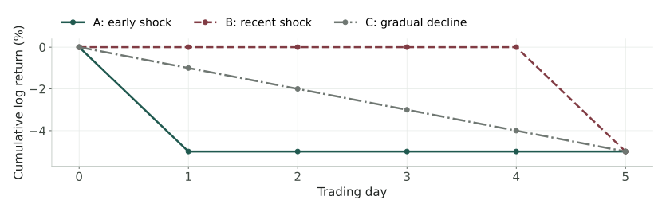
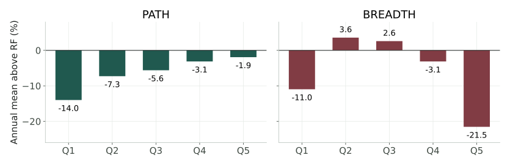
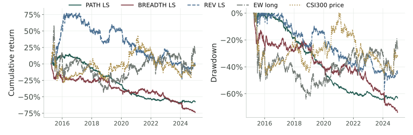
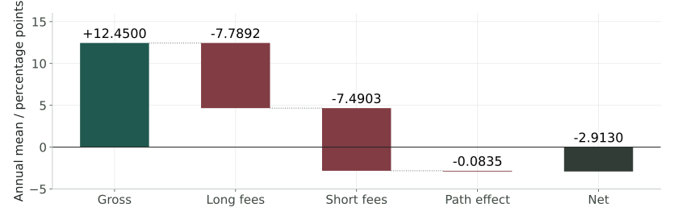
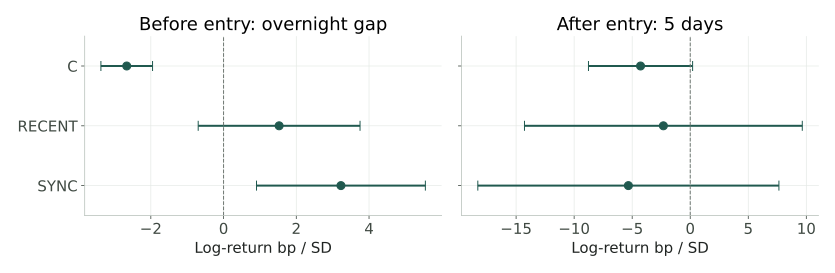
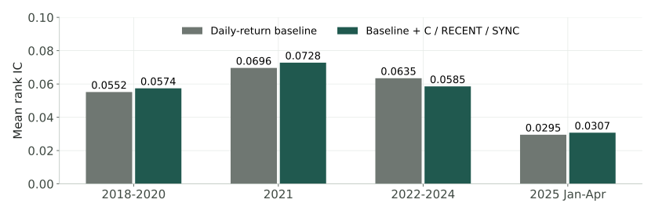

<!-- _class: title -->
<!-- _paginate: false -->

# 同样的跌幅，不同的过程
## A股短期反转的信息增量与执行边界

<div class="meta">量化投资策略 · 小组研究汇报<br>公开日频数据 / 固定方案检验 / 机制与执行诊断</div>

<p class="small">Motivation → 定义与方法 → 数据 → 验证 → 结论</p>

<!--
今天研究的是一个小问题：同样跌了一周，跌法和市场环境是否影响后续反弹？我们先把直觉变成两个可计算的策略，再检验它们是否比普通反转多提供信息，以及收益能否跨过交易成本。最终结果没有支持两个可交易新Alpha，但定位了指标定义、入场时点和执行费用各自的作用。
-->

---

<!-- _class: figure -->

# 相同的累计跌幅，未必是相同的信息



<p class="small">示意路径的累计对数收益都是 −5%，简单收益都是 <strong>exp(−0.05) − 1</strong>。<br>累计收益保留了终点，却丢失了冲击集中度与发生时点。</p>

<!--
先看这个人为构造的例子。早期一次下跌、最后一天突然下跌、每天缓慢下跌，终点完全一样。这里特意用对数收益，避免把连续五天简单跌1%误说成一次跌5%。三个过程可能分别对应已经消化的冲击、尚未消化的新消息和持续卖压。这些只是竞争性解释，需要数据检验。
-->

---


# 两个问题，以及一个共同的检验标准

**H1 · 下跌过程**　累计跌幅相近时，集中下跌与连续下跌的后续收益是否不同？

**H2 · 市场环境**　普跌与局部下跌时，同一个反转信号的预测能力是否不同？

> 目标：过程和环境能否提供**普通反转以外**的信息，并转化为**执行后的经济价值**？

<p class="small">暂时流动性压力可能带来修复；永久信息重估也可能带来延续。</p>

<!--
两项问题都以普通五日反转为参照，而不是从零收益出发。一个因子收益为正，可能只是重新包装了反转。集中下跌也未必是恐慌：重大坏消息同样能导致一天暴跌。因此我们把行为金融解释作为待检验机制，不把价量代理直接解释成投资者心理。本研究是课程层面的定义和执行分析，不主张这个领域此前无人研究。
-->

---


# 定义 1：PATH 的方向与集中度

令 $P_{i,t}$ 为后复权收盘价，过去五日的日对数收益为

$$r_{i,t}=\log\frac{P_{i,t}}{P_{i,t-1}},\qquad R^{(5)}_{i,t}=\sum_{k=0}^{4}r_{i,t-k}.$$

定义损失 $\ell=(-r)_+$、上涨 $g=(r)_+$，各自在五日窗口内计算：

$$C^- = \frac{\max\ell}{\sum\ell},\quad C^+=\frac{\max g}{\sum g},\qquad
\mathrm{PATH}=\begin{cases}C^-,&R^{(5)}<0,\\-C^+,&R^{(5)}>0,\\0,&R^{(5)}=0.\end{cases}$$

<p class="small">其中 (x)₊ = max(x, 0)。负累计收益保证损失分母为正，正累计收益同理。<br>按分数从低到高分 Q1–Q5；高分通常是集中下跌，低分通常是集中上涨。</p>

<!--
PATH不是跌幅乘集中度。它在下跌股票中取最大一天损失占总损失的比例，在上涨股票中取上涨集中度的负数。这样可以按课程要求对全市场排序，但它同时编码了涨跌方向和集中程度。所以Q5减Q1不能直接回答累计跌幅相近时哪种跌法更好，后面要加入控制与条件分组。
-->

---


# 命题 1：集中度不识别日期顺序

对任意五日排列 $\pi$，最大值和总和均不变，因此

$$C(\ell_1,\ldots,\ell_5)
=C(\ell_{\pi(1)},\ldots,\ell_{\pi(5)}).$$

| 五日损失 | 集中度 $C$ | 发生时点 |
| :--- | ---: | :--- |
| $(5,0,0,0,0)$ | 1 | 最早一天 |
| $(0,0,0,0,5)$ | 1 | 最近一天 |
| $(1,1,1,1,1)$ | 0.2 | 均匀分布 |

> **集中度测量“是否集中”，不能单独测量“何时发生”。**

<!--
这不是回测估计，而是指标的代数性质。两种冲击时点得到完全相同的分数，所以不能把集中度结果讲成完整路径效应。测试枚举了五日的120种排列。HHI替代代理也有这个不变性。这个辨析决定了二轮为什么要单独引入RECENT，而不是继续试集中度的不同窗口。
-->

---

<!-- _class: compact data-table -->

# 定义 2：BREADTH 实际是状态切换

在当日有效股票集合 $U_t$ 上，定义下跌比例及其五日均值：

$$b_t=\frac{\sum_{i\in U_t}\mathbf{1}(r_{i,t}<0)}{|U_t|},\quad
B_t=\frac{1}{5}\sum_{k=0}^{4}b_{t-k},\quad
\mathrm{REV}_{i,t}=-R^{(5)}_{i,t}.$$

$$\mathrm{BREADTH}_{i,t}=(2B_t-1)\,\mathrm{REV}_{i,t}.$$

| 市场状态 | 排序结果 | 策略含义 |
| :--- | :--- | :--- |
| $B_t>0.5$ | 与 REV 同序 | 反转 |
| $B_t<0.5$ | 与 REV 反序 | 动量 |
| $B_t=0.5$ | 全部同分 | 无法形成五个不同分数组 |

<!--
共同的正标量不改变横截面排序，负标量只会反转排序。等权五分组也不会因为正标量更大就提高仓位。因此这个公式并没有创造同一状态中的新选股信息，而是把市场广度变成反转和动量之间的开关。普跌时反转可能更强，并不能逻辑推出非普跌时应该做动量；这是原实现额外加入的假设。
-->

---


# 把“有效”拆成可分别检验的问题

| 层次 | 方法与对照 | 支持主张需要什么 |
| :--- | :--- | :--- |
| 排序差异 | 全市场 Q1–Q5；Q5−Q1 | 固定方向下的收益梯度 |
| 风险调整 | CAPM、FF3、Carhart4 | 正 Alpha 与多重校正 |
| 信息增量 | REV 基线；条件排序；回归 | 相近跌幅和常见特征之外的差异 |
| 预测增量 | 逐年冻结：基线 vs 增强 | 配对秩 IC / 误差改善 |
| 执行价值 | 次日开盘、真实成交额计费 | 净收益与调仓成本对照 |

<p class="small">第一轮主检验：PATH、BREADTH 的正四因子 Alpha，双侧 p 值做 Holm(2) 校正。<br>原固定留出结果与事后探索分别报告，不用后者替换前者。</p>

<!--
这张表就是整项工作的逻辑。分组图回答排序有没有区别，风险模型检查风险暴露，REV和强控制检查是不是已有信号的替身，预测比较检查能否产生额外排序信息，账户检查这些信息能不能交易。每一层都可能失败，不能拿其中一个好看的指标替代所有其他证据。
-->

---


# 固定公开行情与可观察样本

**F.I.R.E. · AStockData.tar.gz**　约 1.4 GB，直接读取真实 Feather。

| 项目 | 本地审计结果 |
| :--- | :--- |
| 原始日期范围 | 2015-01-05 至 2025-04-30 |
| 矩阵规模 | 2,509 个日期 × 5,363 列证券代码 |
| 沪深代码前缀筛选后 | 5,362 列历史记录，并非每天都有有效交易 |
| 主要字段 | 复权 open / close、成交量额、市值、PB |

<p class="small">不使用当前成分股倒推历史总体。缺少官方退市主表和财务 PIT 认证，<br>“全市场”仅指文件中形成日符合条件的可观察沪深样本。</p>

<!--
公开可下载解决的是可复现门槛，不自动解决样本偏差。5362是历史代码列数，不是每天可交易股票数。我们使用十个字段而不是只拿收盘价做信号，这样才能检查停牌成交、规模和费用。原始包不放进GitHub，因为公开下载不等于获得再分发许可。数据的准确版本由实际下载摘要固定。
-->

---

<!-- _class: compact -->

# 从公开归档导入真实数据

在仓库根目录激活 Python 环境后，进入研究模块：

```bash
cd study
BASE=https://github.com/fire-institute/fire/releases/download/marketdata
curl -L --fail --retry 3 -C - \
  -o data/AStockData.tar.gz "$BASE/AStockData.tar.gz"
python run_study.py --extract
```

$$\text{固定包与摘要}\ \longrightarrow\ \text{十字段白名单}\ \longrightarrow\
\text{单位 / 缺失审计}\ \longrightarrow\ \text{形成日特征}$$

**读取原则**　`pandas.read_feather` 直接读字段；缺字段报错。

<p class="small">用归档摘要固定数据版本；不使用无效字段的随机回退数据。</p>

<!--
这是实际可以执行的入口，不是伪代码。运行前先按RUN指南核对已有结果记录的SHA，确认拿到同一份包。选择性解压只接受指定的十个普通Feather文件，不执行包里的内容。真实数据、聚合结果和展示材料分别存放，避免图表生成时重新拉取一个已经变化的数据版本。
-->

---


# 形成日过滤与证据阶段

**第一轮股票池**　累计至少 60 次正收盘观察；有效五日收益；形成日正成交量。合格股票少于 100 只时，不建立新目标组合。

| 区间 | 第一轮身份 | 后续分析身份 |
| :--- | :--- | :--- |
| 2015–2020 | 开发 | 历史估计 |
| 2021 | 验证 | 已查看样本 |
| 2022–2024 | 原固定留出 | **复用样本，探索性** |
| 2025.01–04 | 不参加原回测 | 短期扩展，完整五日标签仅 15 期 |

<p class="small">二轮另要求形成窗口五天都有正成交量，因此两轮估计对象并不完全相同。<br>首轮方案先于结果冻结；不根据收益翻转方向、搜索窗口或选成本。</p>

<!--
必须区分程序没有读取未来和研究者没有见过结果。二轮按年冻结训练可以避免训练代码看未来，但我们已经看过2022到2024的回测，所以它不能再叫全新样本外。2025也只有四个月和15个五日标签，适合作为短扩展，不足以宣称稳定验证。这些是结论的证据等级，不是报告附带的一句免责声明。
-->

---


# 信号形成后，最早在下一开盘入场

$$\underbrace{t\text{ 日收盘}}_{\text{信号与股票池}}
\quad\longrightarrow\quad
\underbrace{t+1\text{ 日开盘}}_{\text{先卖后买}}
\quad\longrightarrow\quad
\underbrace{\text{逐日收盘}}_{\text{现金 + 持仓估值}}$$

1. 按形成日平均百分位秩分 Q1–Q5，同分股票不按代码强行拆开。
2. 缺失 / 非正开盘、全天零成交，不执行订单。
3. 开盘跳涨 ≥9.5% 不买；跳跌 ≤−9.5% 不卖，作为统一保守代理。
4. 买不到留现金，卖不出保留旧仓；不根据未来结果重新分配权重。

<p class="small">正成交量不保证开盘一定能成交；旧价延续估值、分数股与统一涨跌幅代理<br>不等同于真实交易所订单、整手或板块限制。</p>

<!--
先把时间顺序说清楚。完整五日信号在当天收盘后才知道，不能假装已经按当天收盘价买入。我们的账户下一开盘先卖再买，钱不够就缩减买入，没成交则保留现金或旧仓。涨跌幅约束是简化的保守代理，而不是所有板块精确规则。停牌期间的旧价沿用也可能高估不可变现资产的价值。
-->

---


# 交易成本跟着成交额，而不是持有天数

以单边 $c=10\mathrm{bp}=0.001$ 为主情景：

$$F_t=c\bigl(V_t^{\rm buy}+V_t^{\rm sell}\bigr),\qquad
r_t^{\rm net}=\frac{\mathrm{NAV}_t}{\mathrm{NAV}_{t-1}}-1.$$

**合成多空**按独立归一化的 100% Q5 减 100% Q1 定义。

$$r_t^{\rm LS}=r_t^{Q5,\rm net}-r_t^{Q1,\rm net}-2f_t^{Q1},\qquad
f_t^{Q1}=\frac{F_t^{Q1}}{\mathrm{NAV}_{t-1}^{Q1}}.$$

<p class="small">减去 Q1 净收益会把其费用加回，所以再扣 2f，才能让两腿各承担一次费用。<br>合成差额不是有真实融券、融资和空头方向成交约束的多空账户。</p>

<!--
10个基点意味着每交易一元收千分之一，买卖分别计费，不是每年收一次千分之一。最容易出错的是直接用两条已扣费的多头净收益相减，那会把低分组的费用当成收益加回来。这里额外扣两倍Q1费用后，多空两腿才各自承担一次成本。但Q1仍来自多头账户，因此我们把它准确叫合成多空研究指标。
-->

---

<!-- _class: compact data-table -->

# 三种资产定价结构，共同样本比较

月度组合收益 $y_m$ 回归；多头减 RF，多空差额不再扣 RF：

$$y_m=\alpha+\boldsymbol\beta^\top\mathbf f_m+\varepsilon_m.$$

| 模型 | $\mathbf f_m$ | 因子含义 |
| :--- | :--- | :--- |
| CAPM | MKT | 市场超额收益 |
| FF3 | MKT, SMB, HML | 加入规模、价值 |
| Carhart4 | MKT, SMB, HML, MOM | 再加入动量 |

**统一口径**　年化 Alpha = $12\alpha$；月频 HAC(3)；留出期共同 36 个月。

<p class="small">采用本地 FF 式代理，非官方标准序列。RF 主假设年化 1.5%，另查 0% / 3%。<br>只有 Alpha &gt; 0 且两主检验 Holm 校正 p &lt; 0.05，才支持正 Alpha 假设。</p>

<!--
模型结构满足CAPM、三因子、四因子的比较要求，但不能把本地重建代理说成官方中国因子。SMB是小盘减大盘，HML是高账面市值比减低账面市值比，MOM是过去动量赢家减输家。我们在同一月份集合里比较，避免模型结果变化其实来自样本变化。显著负Alpha不是成功发现原方向的正Alpha。
-->

---

<!-- _class: figure -->

# 五分组：PATH 有梯度，BREADTH 没有



<p class="small">2022–2024，单边10bp，多头账户；纵轴为超 RF 的年化均值，<strong>不是 Alpha</strong>。<br>PATH Q5 的年化均值仍为 −0.44%；看到梯度还不能证明新信息。</p>

<!--
两张图都从低分Q1排到高分Q5，没有按结果换方向。PATH确实呈现总体改善，但高分多头账户也没有正的年化均值。BREADTH高分组反而很差。注意纵轴减的是固定无风险假设，不是减市场收益，更不是回归Alpha。附录给出每组的三模型Alpha，避免只挑对我们有利的分组展示。
-->

---

<!-- _class: figure -->

# 全期收益与回撤提供风险背景



<p class="small">2015–2024：PATH / BREADTH / REV 为 10bp 合成多空；EW 为同成本多头；<br>沪深300为无费用、无分红的价格指数。敞口不同，曲线高低不能直接解释为 Alpha。</p>

<!--
全期曲线用来看到风险如何累积，包括开发、验证和原留出期，不能替代留出期主检验。曲线上的多空差额是每日差额复利累计，不是具备保证金融券的真实净值。市场参照是沪深300价格指数，与风险模型中重建的MKT不是一个东西，也不参与我们选择策略。
-->

---

<!-- _class: compact -->

# 两个正 Alpha 主假设均未获支持

| 2022–2024 合成多空 | 零成本年化均值 | 10bp 年化均值 | 10bp CAGR |
| :--- | ---: | ---: | ---: |
| PATH | **12.45%** | **−2.91%** | −3.20% |
| BREADTH | −10.71% | −24.51% | −22.80% |

| 10bp 年化 Alpha | CAPM | FF3 | Carhart4 | 主检验 Holm p |
| :--- | ---: | ---: | ---: | ---: |
| PATH | −2.38% | −0.65% | +0.67% | 0.921 |
| BREADTH | −24.60% | −26.45% | −27.92% | 0.002 |

> PATH 的四因子截距接近零；BREADTH 是**显著负** Alpha。

<p class="small">三个模型都采用本地代理。负 Alpha 的较小 p 值不支持原来的正方向假设。</p>

<!--
这里区分三件事：年化算术均值、复合收益和风险模型截距。PATH从12.45降到负2.91是算术均值的变化，后面才能准确加减成本；CAGR不是那个可加减量。PATH的正四因子Alpha只有0.67%，校正p为0.921。BREADTH的校正p很小，但截距为负，因此它反对而非支持原假设。
-->

---

<!-- _class: figure -->

# 12.45% 到 −2.91%：费用可以逐项对账



<p class="small">2022–2024算术年化分解；两腿各自归一化，年成交额约 <strong>153 倍</strong>，费用约 <strong>15.28 pp</strong>。<br>固定持仓的线性盈亏平衡约 8.09bp，未含借券费用，只作诊断。</p>

<!--
先扣Q5实际费用7.7892个百分点，再扣Q1实际费用7.4903个百分点，另有0.0835个百分点来自费用改变资金和持仓路径，最终是负2.9130%。153倍是两条独立归一化账户成交额的和，不是一个100%净资本账户的换手。盈亏平衡费用是固定持仓的线性估计，不能据此挑一个更低成本再宣称盈利。
-->

---


# BREADTH 的问题在扣费之前已出现

| 2022–2024 形成状态 | 事件数 | REV 五日事件毛差额 | 切换规则下差额 |
| :--- | ---: | ---: | ---: |
| $B\leq0.5$ | 72 | +0.54% | **−0.54%** |
| $B>0.5$ | 72 | −0.02% | −0.02% |

**定义诊断**　非普跌状态中的反转差额为正，原规则却强制做动量。

**独立检验**　控制市场五日收益和波动后的广度条件关系，$p=0.907$。

> 广度条件作用与反转 / 动量切换，是两个不同假设。<br>当前数据未支持原切换方向，也未支持独立调节关系。

<!--
这一页解释为什么不能把两个因子都归咎于手续费。BREADTH零成本年化就已经是负10.71%。在72个非普跌事件里，普通反转平均正0.54%，乘负号会把正差额变成负差额。这个表是事件标签而不是实际账户的严格收益分解。我们还单独做了广度条件回归，也没有证据支持其独立作用。事后把整个策略反号不能验证原假设。
-->

---

<!-- _class: compact -->

# 分开测量集中度、时点与同步性

只保留五日下跌股票。令 $j=0,\ldots,4$ 表示从最早到最近一天，

$$w_{i,j}=\frac{(-r_{i,j})_+}{\sum_{k=0}^{4}(-r_{i,k})_+},\qquad
C_i=\max_jw_{i,j},\qquad \mathrm{RECENT}_i=\sum_{j=0}^{4}w_{i,j}\frac{j}{4}.$$

$$\mathrm{SYNC}_i=\sum_{j=0}^{4}w_{i,j}
\left(b_{-i,j}-\frac15\sum_{k=0}^{4}b_{-i,k}\right).$$

**含义**　$C$ 测量损失集中程度；RECENT 从 0（最早）到 1（最近）；SYNC 衡量损失与市场下跌日期的对齐。

<p class="small">b₋ᵢ 为剔除自身的下跌比例；减去窗口均值突出时间对齐。均为代理，不是因果机制观测。</p>

<!--
这一步是定义诊断后的有针对性扩展。RECENT用损失份额加权日期，弥补集中度看不见顺序的问题。SYNC先剔除自身，避免把自己的下跌直接计入市场状态，再对五日均值中心化，研究个股损失与市场下跌日期是否对齐。我们没有把这三个指标打包成一个事后最优分数，而是同时放进模型，分别公布结果。
-->

---

<!-- _class: compact -->

# 用强控制和入场前后标签定位增量

每个形成日，对下跌股票做横截面回归：

$$y_{i,t,h}=a_{t,h}+\beta_C\widetilde C_{i,t}
+\beta_R\widetilde{\mathrm{RECENT}}_{i,t}
+\beta_S\widetilde{\mathrm{SYNC}}_{i,t}
+\boldsymbol\gamma^\top\mathbf X_{i,t}+\varepsilon_{i,t,h}.$$

**强控制 $\mathbf X$**　五个逐日收益 + 20日波动、log市值、log原价、非流动性。特征按形成日缩尾、标准化，不用未来标签决定分组。

| 标签 | 对数价格比 | 研究含义 |
| :--- | :--- | :--- |
| 入场前 gap | $\log[O_{t+1}/P_t]$ | 原策略尚未成交 |
| 入场后 $h$ 日 | $\log[O_{t+h+1}/O_{t+1}]$ | $h=1,5,20$ |

<p class="small">O 为复权开盘；P 为复权收盘。事件标签无现金、成交和费用约束。<br>主探索比较为三个五日系数 Holm(3)，另公开全部 24 项比较的 Holm 校正。</p>

<!--
为什么用五个逐日收益？它比只控制累计收益更强，避免非线性过程指标只是重复最近一天的价格信息。系数检验回答相对于这个线性基线是否还有增量，不意味着已经控制所有非线性关系。标签拆成入场前的低开和入场后的收益，防止把无法捕获的价格变化算成交易收益。多重检验校正也不能消除跨轮探索的选择风险。
-->

---

<!-- _class: figure -->

# 可辨认的缺口关系，不等于五日预测增量



<p class="small">探索性分析，复用2022–2024；强控制，误差线为逐项95% HAC区间。<br>C 的入场前缺口系数 −2.66 bp/SD，24项 Holm p = 4.8×10⁻¹²。<br>入场后五日 C / RECENT / SYNC 的 Holm(3) p = <strong>0.184 / 0.841 / 0.841</strong>。</p>

<!--
横轴是对数收益基点，每提高一个标准差特征，对应的条件系数是多少。区间是逐项HAC置信区间，显著性还要看校正。集中度和次日低开关系较清楚，但我们是在低开后的开盘入场。五日三个系数均没有通过主探索校正。这不意味着原PATH的全部毛收益都发生在开盘前，因为样本和控制口径都不同。
-->

---

<!-- _class: figure -->

# 增强模型没有带来稳定的排序改善



<p class="small">探索性预测比较；每年只用年初以前完整标签估计系数，年内冻结。<br>复用2022–2024：秩 IC <strong>0.0635 → 0.0585</strong>，配对差 −0.0049，HAC p = 0.085。</p>

<!--
秩IC是同一天预测分数和后续收益的Spearman相关。增强模型只是在同一基线上加C、RECENT、SYNC，保证比较对象明确。基线在2022到2024为0.0635，增强后0.0585，没有提升。p为0.085，因此也不能按5%阈值断言增强模型有害。2025略改善但只有15期，不能靠这四个月推翻前面的证据。
-->

---

<!-- _class: compact data-table -->

# 固定半量调仓：少付费用，也少拿毛收益

完整目标份额为 $q^*$，当前份额为 $q$，只执行一半距离：

$$q^{\rm HALF}=q+0.5\,(q^*-q).$$

| PATH Q5 多头，2022–2024 | FULL | HALF |
| :--- | ---: | ---: |
| 年化算术均值 | −0.44% | +1.04% |
| CAGR | −3.57% | **−2.03%** |
| 年化费用 | 7.79% | 3.87% |
| 年成交额 / 净值 | 77.96 倍 | 38.75 倍 |

**净均值改善 1.48 pp = 费用节省 3.92 pp − 实际持仓毛收益损失 2.44 pp。**

<p class="small">探索性对照：仅比较固定 50% 与 100%，未搜索最优比例。重新模拟现金与成交，不把收益直接减半。</p>

<!--
机制变量没有稳定增量后，仍然可以提出一个有边界的执行问题：在现有信号上少交易一些会怎样？这里不优化参数，只对照固定一半和全量。费用确实减少，但旧仓和现金改变了实际暴露，也损失毛收益。净算术均值改善1.48个百分点，却仍是负CAGR，不能把这叫做盈利策略修复，更不能称市场中性Alpha。
-->

---


# 验证实现，同时约束证据能支持的结论

| 检查 | 完成的验证 | 不能由此推出 |
| :--- | :--- | :--- |
| 27 项单元测试 | 排列不变性、时点、零成交、费用、半量调仓 | 所有真实交易约束已建模 |
| 3 份原账户对账 | 扩展 FULL 与原账户最大误差为 0 | 新执行策略已经盈利 |
| 费用恒等式 | 毛收益、双腿费用、持仓路径逐项相抵 | 10bp 是真实历史全部成本 |
| 训练时间检查 | 训练标签终点早于预测年开始 | 二轮获得全新留出样本 |


<!--
这一页可以回答工作量在哪里，但不把测试数量当研究贡献。实现核验解决的是有没有算错、有没有混用版本；研究有效性还要看基线、样本和识别条件。原账户对账说明增加半量调仓功能时，默认全量行为没有改变。冻结指纹防止新表格和旧正文拼接成一份不一致的报告。
-->

---


# 当前边界决定下一步需要什么数据

| 识别或执行边界 | 会影响什么 | 下一步固定设计 |
| :--- | :--- | :--- |
| 退市主表 / 财务 PIT 未认证 | 样本与风险代理 | 补历史状态和公告可得时间 |
| 价量无法区分信息与卖压 | 行为机制解释 | 公告 / 行业事件标签，事先分层 |
| 旧价、统一限价、合成空头 | 可执行收益 | 真实交易状态、方向约束与融券数据 |
| 已复用样本、短期扩展 | 外推与选择风险 | 新时间段，先冻结再观察 |

> 下一步增加**识别信息与独立验证**。<br>本轮不再通过反号、换窗口或挑费用来制造成功结果。

<!--
研究下一步应该针对当前证据的缺口，而不是继续试更多相似价量公式。公告标签可以区分可能的信息重估和非事件下跌，历史状态与真实交易约束可以提升样本和执行可信度。新验证需要在观察结果之前固定设计；换一个数据源但年份和上游相同，也不能直接当独立复制。
-->

---


# 结论：测量、增量与执行必须分别成立

**测量辨析**　集中度对日期排列不变；共同广度倍数只改变排序方向。直觉问题与策略公式之间存在额外假设。

**增量定位**　在当前公开A股样本中，强控制与逐年冻结比较没有支持稳定五日增量；入场前缺口关系不能算作入场后利润。

**执行核算**　PATH 的毛收益被高成交额费用抵消；固定半量调仓量化了费用节省与毛收益损失，尚未获得正 CAGR。

> 本研究给出可复核的**指标解释与执行边界**，<br>没有把两个未通过检验的策略包装成可交易新 Alpha。

<!--
最后回到最开始的问题。我们没有证明价格过程或市场状态普遍无用，而是在这个固定定义和样本中，没有发现稳定可交易的新Alpha。完成的贡献是证明两个指标究竟在测什么，建立针对性的增量与时点比较，并用账户把成本差异对上。这个结论范围有限，但每一项都可以回到公式、测试或结果表核查。
-->

---

<!-- _class: compact data-table -->

# 算术均值、复利、Alpha 不可互换

$$\mu_{\rm ann}=252\overline r,\qquad
\mathrm{CAGR}=\left[\prod_{t=1}^{N}(1+r_t)\right]^{252/N}-1.$$

$$\mathrm{Sharpe}=\sqrt{252}\,\frac{\overline{r-r_f}}{s(r-r_f)},\qquad
\mathrm{MDD}=\min_t\left[\frac{\mathrm{NAV}_t}{\max(1,\mathrm{NAV}_1,\ldots,\mathrm{NAV}_t)}-1\right].$$

| 对象 | 收益口径 | 解释 |
| :--- | :--- | :--- |
| 账户 | 净值简单收益 | 含现金、成交限制、费用 |
| 第一轮事件 | $O_{t+6}/O_{t+1}-1$ | 五日毛简单收益 |
| 二轮事件 | $\log(O_{t+h+1}/O_{t+1})$ | 毛对数收益；非可执行账户 |
| 风险回归 | 日收益复利成月，再回归 | 年化截距乘 12 |

<p class="small">多空 Sharpe 不再减 RF。费用恒等式使用算术均值，不能用 CAGR 做同样加减。</p>

<!--
遇到收益口径追问时回到这页。252倍平均收益是加法量，适合成本分解；CAGR取决于波动和逐日路径。事件标签没有扣费，也没有可成交性检查。二轮使用对数收益，因此不能把一个二轮系数直接加到第一轮账户年化收益上。
-->

---

<!-- _class: compact data-table -->

# Q1–Q5 的三模型年化 Alpha

<p class="small">2022–2024，单边10bp，多头账户；三种模型均使用本地风险代理。</p>

| 多头分组 | CAPM | FF3 | Carhart4 |
| :--- | ---: | ---: | ---: |
| PATH Q1 | −9.63% | −13.07% | −13.60% |
| PATH Q2 | −4.28% | −7.21% | −7.55% |
| PATH Q3 | −2.32% | −6.68% | −6.97% |
| PATH Q4 | +0.77% | −1.36% | −0.83% |
| PATH Q5 | +2.38% | +0.57% | +1.42% |
| BREADTH Q1 | −5.00% | −6.12% | −4.70% |
| BREADTH Q2 | +8.04% | +6.99% | +7.17% |
| BREADTH Q3 | +5.86% | +2.21% | +1.83% |
| BREADTH Q4 | −0.33% | −5.46% | −6.22% |
| BREADTH Q5 | −19.20% | −23.00% | −23.16% |

<!--
这张表是各个多头账户的风险调整结果，不是把多空回归拆成两半。所有模型使用共同月份集合和相同成本口径。分组Alpha不是事先定义的两个主要假设，不从十个组里挑一个最大的截距宣称策略成功。
-->

---

<!-- _class: compact data-table -->

# 输入字段、替代代理与条件比较

| 输入 | 用途 |
| :--- | :--- |
| open、close、close_dr | 复权收益与成交；原价控制 |
| volume、money | 零成交检查；Amihud 非流动性 |
| market_cap_ashare、circulating_market_cap_ashare | 规模、滞后加权广度与风险代理 |
| pb_ratio、return_adj、turnover_ratio | 价值代理、收益单位核验与字段审计 |

**辅助检验**　HHI 集中度、流通市值加权广度、规模 / 价格 / 非流动性独立双重排序、分时期、RF 0% / 1.5% / 3%、成本 0 / 10 / 30bp。

**原 PATH 增量回归**　控制 R5、R1 等后，五日系数 −2.16 简单收益 bp/SD，$p=0.255$。不以某个子组接近阈值替代主检验。


<!--
辅助结果全部保留在CSV里。HHI和加权广度是固定替代代理，不是看了表现后选出的最佳参数。独立双重排序检查结果是否局限于小盘、低价或者难交易股票。累计跌幅三分组内比较仍是粗条件比较，不能声称严格匹配或因果识别。
-->
